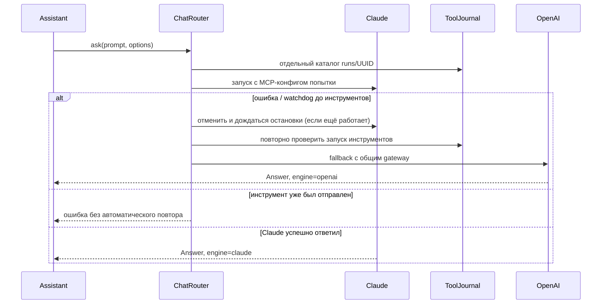

# ИИ, инструменты и переключение провайдеров

## Границы компонентов

`Assistant` отвечает за смысл запроса: контекст, шаблоны, схему ответа и применение
памяти/задач. `Brain` и `OpenAIBrain` отвечают за протокол провайдера. `ChatRouter`
решает, можно ли переключить текущий запрос. `ToolGateway` предоставляет модели
единый интерфейс возможностей; `ToolRegistry` проверяет аргументы и выполняет
зарегистрированные функции.

Исходники: [assistant.py](../ubermensch/assistant.py), [brain.py](../ubermensch/brain.py),
[openai_brain.py](../ubermensch/openai_brain.py), [runtime](../ubermensch/runtime/),
[capabilities](../ubermensch/capabilities/), [tools.py](../ubermensch/tools.py).

Два провайдера имеют похожий метод `ask(...) -> Answer`, но полноценный интерфейс
провайдеров пока не выделен: `Answer` и `BrainError` находятся в `brain.py`,
параметры вызовов частично специфичны для Claude. Это переходная архитектура.

## Контекст и промпты

### Шаблоны и производные файлы

| Источник | Назначение |
|---|---|
| `prompts/system.md` | Основные инструкции, сферы памяти, действия, пути заметок |
| `prompts/telegram.md` | Дополнение для общения через Telegram |
| `prompts/analysis.md` | Короткие инструкции фонового анализа |
| `workspace/anya_persona.md` | Выработанный голос Ани |
| `workspace/tg_style.md` | Стиль владельца в личном Telegram |
| `workspace/tg_style_work.md` | Стиль владельца в рабочем Telegram |

Assistant подставляет `AREAS`, описания старых структурированных actions и пути,
добавляет persona/style и пишет `workspace/system_prompt*.md`. Эти файлы
генерируются; править нужно шаблон или источник стиля. При очередном выборе
промпта содержимое сравнивается, чтобы не переписывать неизменённый файл.

### Контекст чата

`_context()` собирает текущие дату/день недели/offset, пригодный кеш world,
активные цели, до 150 фактов и 40 людей, задачи, ожидающие напоминания и последние
20 сообщений. ID записей включаются в контекст для операций update/forget/merge.
Контекст создаётся до сохранения текущей реплики; сама реплика добавляется отдельно.

Это выборка памяти, а не загрузка всей БД. Нет векторной базы, embeddings и отдельного
RAG-сервиса. Отбор — SQL, importance, свежесть и программные эвристики.

Контекст анализа использует до 400 фактов и 200 людей; связанные люди выбираются
также по важности и упоминаниям. Для некоторых фоновых задач OpenAI включается
фильтр private: исключаются сферы health/personal, часть слов и карточки людей.
Фильтр не является анонимизацией: исходные URL, названия страниц и тексты могут
содержать личные сведения. Резервный чат получает полный контекст и результаты
разрешённых ему инструментов.

## Структурированный ответ

`Answer` содержит `data: dict` и `duration_ms`. В обычном чате `_schema()` требует
все шесть полей:

```json
{
  "reply": "Добавила тестовую задачу.",
  "memory": [],
  "goals": [],
  "tasks": [{"op": "add", "title": "Проверить отчёт", "due": "2026-10-20"}],
  "people": [],
  "actions": []
}
```

| Поле | Операции | Дополнительные поля |
|---|---|---|
| `memory` | `add`, `update`, `forget` | `id`, `area`, `content`, `importance` 1–5 |
| `goals` | `add`, `update`, `done`, `drop` | `id`, `area`, `title`, `details`, `deadline` |
| `tasks` | `add`, `update`, `done`, `drop` | `id`, `title`, `notes`, `due`, `goal_id` |
| `people` | `add`, `update`, `merge` | `id`, `into`, `name`, `relation`, `notes`, `importance` |
| `actions` | `kind` из `actions.REGISTRY` | `summary`, `params` |

Для большинства операций схема требует только `op`, а предметные поля проверяются
дальнейшим кодом. Схема не выражает полноценно условие «для add нужны одни поля,
для update другие». Это важно при добавлении полноценной локальной валидации.
`drop` модели превращается в `dropped` в БД. `people.merge` скрывает дубль;
перенос его заметок в основную запись должен быть отдельным update.

Структурированные actions и общие tools — разные механизмы. В текущем
`actions.REGISTRY` есть напоминание:

```json
{
  "kind": "reminder",
  "summary": "Напомнить о тестовом отчёте",
  "params": {"at": "2026-10-20T10:00:00", "text": "Проверить отчёт"}
}
```

Системные действия над файлами, компьютером и интеграциями выполняются tool calls
во время работы модели. Не нужно добавлять их ещё раз в `actions` итогового JSON.

### Разные задачи — разные схемы

| Сценарий | Поля |
|---|---|
| Чат | reply, memory, goals, tasks, people, actions |
| Обычный импорт | reply, memory, goals |
| Анализ истории | reply, memory, goals, people |
| Глубокий импорт | reply, memory, goals, people, notes |
| Досье | reply, dossier |
| Комментарий экрана | comment, activity |
| Стиль / persona / категории / новости | Специализированные схемы в Assistant |

`Assistant.handle` сохраняет ответ assistant и затем последовательно применяет
изменения. `Outcome` содержит reply, changes, done, pending, engine. Текстовые
changes/done предназначены для отображения. Полной локальной проверки всего
ответа по JSON Schema сейчас нет: OpenAI-код проверяет объект и обязательные
верхние поля, а не каждый вложенный тип/диапазон. Это зафиксированный технический долг.

## Claude Code

`Brain.ask` запускает найденный CLI как дочерний процесс, передаёт запрос через
stdin и ожидает JSON. Существенные параметры команды:

- `-p`, выбор модели, `--output-format json`, `--json-schema`;
- `--system-prompt-file` с сгенерированным промптом;
- `--tools` и allowlist допустимых инструментов;
- `--permission-mode dontAsk`, `--permission-prompts none`;
- `--strict-mcp-config`, `--no-session-persistence`.

Рабочая папка — workspace. Авторизация CLI внешняя по отношению к приложению.
В обычном чате доступны встроенные `WebSearch`, `WebFetch`, `Read`, `Glob`, `Grep`
и MCP-инструменты `ubermensch`. Встроенные Bash/Edit/Write не выдаются. Команды
всё равно возможны через общий `run_shell`, с его собственной политикой.

Модель desktop берётся из Settings; Telegram использует `sonnet` с effort medium,
массовый анализ — `sonnet`. Комментарий экрана использует Read и таймаут 180 секунд.
Это настройки текущего кода, а не универсальные рекомендации по моделям.

CLI-ошибка преобразуется в `BrainError` с категориями по тексту: limit, auth,
missing, timeout, other. Разбор времени снятия лимита также эвристический. На отмене
или таймауте `_terminate` гасит группу процессов Claude (`os.killpg`; CLI запускается
с `start_new_session`), затем при необходимости завершает/дожидается родителя. Это нужно для завершения
MCP и для корректной проверки, не успел ли стартовать инструмент.

## OpenAI и цикл функций

Текущий адаптер вызывает `/v1/chat/completions`, для выбора доступной модели —
`GET /v1/models`. Он формирует system/user messages, JSON Schema ответа и функции
из `ToolGateway.definitions()`. В запросе установлены `store: false`,
`parallel_tool_calls: false`, `strict: false` для схем в соответствующих полях.
Сетевой клиент провайдера использует `trust_env=True`; локальный gateway — false.

Последовательность:

1. Проверить ключ, временную блокировку и остаток расчётного бюджета.
2. Отправить модельный запрос; учесть usage **этого** ответа.
3. Если модель вернула tool calls, проверить лимиты и аргументы, выполнить их
   последовательно через общий gateway.
4. Добавить assistant tool_calls и соответствующие tool messages в историю запроса.
5. Снова вызвать модель или, при завершении, разобрать итоговый JSON.

Инструменты разрешены только при `role=chat` и явно переданном gateway. Фоновой
роли gateway передать нельзя — метод возвращает ошибку. Резервный чат получает
полную схему с actions, поэтому после fallback может создавать и напоминания.

Ограничители:

| Ограничитель | Значение / поведение |
|---|---|
| Модельные раунды с инструментами | До 12, затем принудительный финальный ответ без вызова функций |
| Вызовы в одном ответе модели | Более 16 отклоняются |
| Результат одного инструмента | До 60 000 символов, длинный результат оборачивается как обрезанный |
| Таймаут одного сетевого запроса к провайдеру | 240 секунд |
| Длительность чата с действиями | Отдельный общий предел в вызывающем контуре, 900 секунд |
| Проверка бюджета | До запросов и до исполнения инструментов |

Обычная ошибка аргументов может вернуться модели как tool error для исправления.
`ToolExecutionUncertain` прекращает цикл: модель не получает приглашение повторить
возможно выполненное действие. Вызовы из одного ответа обрабатываются по порядку,
даже если провайдер всё же вернул их несколько.

Встроенных Claude `Read`, `Glob`, `Grep`, `WebSearch`, `WebFetch` у OpenAI нет.
`read_file` даёт чтение UTF-8 текста; `screenshot` возвращает путь, а не передаёт
изображение модели. Поэтому общий каталог даёт функциональные системные инструменты,
но не полную эквивалентность встроенным средствам Claude и не автоматическое зрение.

### Учёт расхода

Модели выбираются из явной переменной, кеша `openai:model:<role>` либо списка
предпочтений по доступным model IDs. `PRICES` выбирается по наиболее длинному
префиксу имени; неизвестная модель оценивается по `UNKNOWN_PRICE`.

Расход суммируется в `openai:spent`, предупреждение по умолчанию на $7, остановка
новой работы на $9. Это локальная оценка usage по таблице кода, не счёт провайдера.
Сброса по месяцам и резервирования денег перед запросом нет. Один уже отправленный
запрос может пересечь лимит; параллельные фоновые/чатовые запросы также могут начать
работу до учёта друг друга. Строгое финансовое ограничение здесь не реализовано.

Ошибки ключа, баланса или региона дают временную блокировку helper на час.
Без helper или при исчерпанном бюджете фоновая работа остаётся на Claude и его
механизме ожидания. Не нужно сбрасывать spend-курсор для устранения сетевой ошибки.

## Переключение чата



Router создаёт `workspace/runs/<uuid>/mcp.json` с переменной журнала, запускает
primary task и проверяет её примерно раз в секунду. Watchdog: 120 секунд Telegram,
180 секунд desktop. Он действует, только если helper доступен, никто не ожидает
решения пользователя и журнал ещё пуст. После отмены primary журнал проверяется
ещё раз, закрывая гонку «инструмент стартовал во время отмены».

Если любой общий инструмент уже dispatched/started, повтор всего запроса другим
ИИ запрещён, включая случай read-only инструмента. Это консервативное правило:
классификации эффекта для более точного переключения пока нет. Оно не является
полным аудитом встроенных Read/WebSearch Claude, которые не проходят общий реестр.

При успехе/ошибке конфиг попытки удаляется. Пустой каталог удаляется; каталог
с непустым `tools.jsonl` сохраняется. Journal содержит строки:

```jsonl
{"tool": "read_file", "status": "dispatched"}
{"tool": "read_file", "status": "started"}
{"tool": "read_file", "status": "completed"}
```

`dispatched` пишется адаптером до отправки; `started` — после проверки аргументов
реестром, перед функцией; `completed` — после возврата; `interrupted` — при
исключении. Completed не означает, что пользователь разрешил действие: функция
могла успешно вернуть отказ. Нет timestamps, параметров, результата, tool_call ID
и fsync-гарантии переживания отключения питания.

## Каталог общих инструментов

В таблицах показана Python-сигнатура без типов там, где они очевидны; точная
JSON Schema всегда доступна через `/api/tools`. `account` принимает personal/work.

### Файлы — `capabilities/files.py`

| Инструмент и аргументы | Результат и особенности |
|---|---|
| `read_file(path, offset=0, limit=12000)` | `{path,text,next_offset}`; UTF-8-sig, offset в символах, limit 1..30000; без подтверждения |
| `find_files(name_part, folder=None, limit=30)` | Список путей по части имени; без подтверждения |
| `write_file(path, content)` | Создание/перезапись UTF-8; проверка защищённой зоны |
| `append_file(path, text)` | Дописывание, перед новым текстом перевод строки при непустом файле |
| `write_word(path, title, markdown)` | DOCX из ограниченного Markdown, расширение принудительно `.docx` |
| `write_excel(path, sheet, rows, append=False)` | XLSX, список строк; append управляет дописыванием |
| `read_excel(path)` | Словарь листов/строк, до 200 строк на лист |
| `move_path(source, destination)` | Перемещение/переименование; проверяются оба конца |
| `delete_to_recycle_bin(path)` | Удаление в Корзину (`gio trash`); подтверждение для защищённого пути |

`read_file` читает последовательно, не загружая весь файл, но для большого offset
проходит предшествующий текст. Это не API чтения бинарных файлов/PDF. Просьба не
читать секреты в docstring не подкреплена отдельным read allowlist.

### Компьютер — `capabilities/computer.py`

| Инструмент и аргументы | Политика |
|---|---|
| `open_item(target)` | Открыть сразу: файл/папку/URL через `xdg-open`, программу — по ярлыку `.desktop` (имя файла или `Name=`) через `gio launch` |
| `run_shell(command, reason)` | Выполнить в bash сразу, если `shell.is_dangerous` не требует подтверждения |
| `media_key(action, times=1)` | play_pause, next, previous — плееру MPRIS (играющему или на паузе); volume_up/down, mute — PipeWire `wpctl` |
| `screenshot()` | Проверить активное окно, снять Spectacle, сохранить `screens/request.jpg`, вернуть путь |
| `lock_screen()` | `loginctl lock-session` сразу |

bash работает с правами процесса пользователя (без пароля sudo). Определение опасной команды — эвристика,
не парсер семантики произвольной программы и не sandbox. Она не гарантирует
невозможность обойти подтверждение через косвенный вызов.

### Связь — `capabilities/communication.py`

| Инструмент и аргументы | Политика |
|---|---|
| `telegram_find_chats(query, account='personal')` | Чтение |
| `telegram_read(chat_id, limit=30, account='personal')` | Чтение актуальных сообщений из Telegram |
| `telegram_send(chat_id, text, account='personal')` | Обязательное подтверждение полного текста и получателя |
| `email_send(to, subject, body)` | Обязательное подтверждение письма |

### Календарь — `capabilities/calendar.py`

| Инструмент и аргументы | Политика |
|---|---|
| `calendar_upcoming(days=14)` | Чтение primary calendar |
| `calendar_add(title, start, end=None, description='', reminder_minutes=None)` | Создание сразу |
| `calendar_delete(event_id)` | Свои события сразу, остальные с подтверждением |

Start/end — дата целого дня либо локальный datetime; при отсутствии end выбирается
следующий день или час спустя в зависимости от формата. «Своё» определяется
маркером в description; это редактируемый текст, а не защищённый ownership ID.

### Вуз — `capabilities/university.py`

| Инструмент и аргументы | Назначение |
|---|---|
| `university_search(query, limit=10)` | Поиск по публичному сайту |
| `university_read(url)` | Страница/документ; адрес кабинета передаётся соответствующему адаптеру |
| `lk_find(query, limit=5)` | Поиск в последнем снимке кабинета |

## Где применяются политики

`config.is_protected` сначала учитывает свободные зоны: workspace и папку Ани
(`~/Документы/Аня`). Затем защищает системные каталоги (`/etc`, `/usr`, `/boot`…),
`~/.ssh`, `~/.gnupg`, `~/.local/bin`, DATA_DIR и проект. Обычные
файлы вне этих защищённых мест разрешены для записи без подтверждения.

`ToolRegistry` создаёт Pydantic-модель по аннотациям/значениям по умолчанию и запрещает
extra fields. Реестр не определяет права сам: предметные политики находятся в
capabilities/Core. Токен API не отправляется модели; его читает gateway. MCP-адаптер
сохраняет сигнатуры через wraps и вызывает тот же HTTP endpoint, что OpenAI.

При следующем рефакторинге желательно выделить явный execution context и политику
вместо внутренних HTTP-callbacks. Сохранить поведение отказа, проверку перед эффектом
и тесты гонок; только перенос функций по каталогам этого не обеспечивает.
