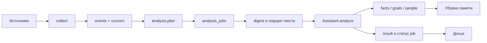

# Фоновые службы, сбор и анализ

Обновление 23 октября 2026: сохраняемые runs/calls/approvals, outbox, транзакции,
права фонового агента и восстановление описаны в [RELIABILITY](RELIABILITY.md).
Поручение, прерванное при выполнении, требует проверки и нового явного продолжения;
автоматического повтора после рестарта нет.

## Службы ядра

В [`__main__._serve`](../ubermensch/__main__.py) регистрируются одиннадцать корутин.
Они выполняются в одном event loop, а блокирующие адаптеры по необходимости
выносят I/O в потоки.

| Служба | Реализация | Период / запуск |
|---|---|---|
| Напоминания | `Core.reminder_loop` | Проверка каждые 20 секунд |
| Окно в мир | `Core.world_loop`, `world.py` | Сразу, затем каждые 3 часа |
| Импорт документов | `Core.import_loop` | Через 10 секунд, затем каждые 5 минут |
| Трекер активности | `collectors/activity.py` | Сэмпл каждые 5 секунд |
| Сбор данных | `Investigation.collect_loop` | Через 20 секунд, затем каждые 2 часа |
| Разбор данных | `Investigation.worker` | Через 90 секунд; пауза зависит от нагрузки |
| Взгляд на экран | `ScreenObserver.run` | Случайная пауза 2–4 часа перед взглядом |
| Обслуживание | `Maintenance.run` | Проверка каждые 10 минут |
| Профиль | `profiling.Profiler.run` | Через 10 минут; затем проверка раз в час, перестройка раз в неделю или по запросу |
| Интервью | `interview.Interviewer.run` | Проверка раз в 30 минут; вопрос — не чаще раза в 20 часов |
| Самостоятельность | `agent.Autonomy.run` | Раз в минуту: расписание → рефлексия → поручения → heartbeat раз в 30 минут (9:00–24:00) |

[`Supervisor`](../ubermensch/services.py) перезапускает неожиданно завершившуюся
службу с backoff 5, 10, 20… до 300 секунд. После более 600 секунд успешной работы
сбрасывается backoff. Счётчик restarts остаётся накопительным для жизни процесса.
Начиная с трёх перезапусков создаётся Health-проблема; до десяти она quiet.
Успешный старт сам по себе эту проблему не очищает.

Отмена при остановке ядра передаётся службам; `CancelledError` нужно пробрасывать.
`Supervisor` не хранит задания и состояние перезапусков в БД. Разовые задачи,
созданные через `asyncio.create_task` в HTTP collect/voice/deep, не становятся
зарегистрированными службами с такой же политикой наблюдения.

## Health и шина

[`Health`](../ubermensch/health.py) хранит проблемы в памяти по ключам. Видимые
поля: key, message, since. Повторные уведомления ограничены интервалом в шесть
часов; quiet-проблема видна в состоянии, но не вызывает обычное уведомление.
Bind к event loop позволяет безопасно передать уведомление из рабочего потока.
Очистку конкретной проблемы должен вызвать владеющий ею компонент.

`Core.notify` сохраняет assistant/system сообщение и публикует notify/changed.
`Core.say` — только краткий сигнал desktop. `Bus` — очереди текущих подписчиков,
не журнал надёжной доставки. Для будущих фоновых jobs нужны отдельные durable
состояния, а не расширение объёма сообщений Bus.

## Контур расследования

`Investigation.collect()` защищён флагом `collecting`. Если сбор уже идёт,
повторный вызов возвращает пустой результат. Ошибки отдельных источников
обрабатываются локально, чтобы один недоступный аккаунт не останавливал весь обход.
События добавляются через Store, после сбора вызывается планирование.

Основное окно истории — 365 дней; для Takeout — два года. Документы, архивы чатов
с ИИ и творчество считаются медленными источниками и обходятся не чаще суток.
Категории активности и университет обновляются раз в 20 часов, стиль — раз в неделю.
Эти интервалы — константы Python, соответствующих переменных `.env` пока нет.

## Источники и их границы

| Источник / модуль | Что поступает | Состояние и особенности |
|---|---|---|
| `telegram` / `collectors/telegram.py` | Переписки личного и рабочего аккаунтов | Telethon-сессии отдельно; курсор по чату и аккаунту; лишняя групповая переписка фильтруется |
| `gmail` / `collectors/gmail.py` | Письма | Нужны адрес/пароль приложения; IMAP чтение через BODY.PEEK |
| `chrome` / `collectors/chrome.py` | История браузера из локального профиля | Копирование/чтение локальной БД, собственный курсор |
| `ai_chat` / `collectors/ai_chats.py` | Реплики владельца из локальных сессий и экспортов чатов | Отдельный путь от глубокого AI Studio импорта |
| `document` / `collectors/documents.py` | Тексты поддерживаемых документов | Личные папки (`config.PERSONAL_DIRS`: XDG «Документы», «Загрузки», «Рабочий стол», `~/Учеба`…) и `UBERMENSCH_ROOTS` |
| `creative` / `collectors/creative.py` | Признаки творческих проектов/файлов | Обход личных папок и `UBERMENSCH_ROOTS` с исключениями; не чтение всех бинарников как текста |
| `notification` / `collectors/notifications.py` | Уведомления программ и сайтов из журнала `raw/notifications`, который ядро пишет, слушая D-Bus | Только пока ядро запущено: система историю уведомлений не хранит |
| `power` / `collectors/power.py` | Сон ноутбука из системного журнала (systemd-sleep): уснул — проснулся | Нужна группа adm или systemd-journal; включения не берутся — часы сдвигаются при двойной загрузке с Windows |
| `music` / `collectors/listening.py` | Что играло в плеерах MPRIS (Spotify, браузер, VLC…) — журнал `raw/listening`, который ядро пишет раз в 15 секунд | Только пока ядро запущено; трек короче 15 секунд может не попасть |
| импорт / `collectors/gdrive.py` | Чаты Gemini в AI Studio с Google Диска (`application/vnd.google-makersuite.prompt`), изменившиеся с курсора `gemini`, раз в 6 часов → `raw/import/Gemini — <название> [id].json` → глубокий импорт | Нужен вход Google с `drive.readonly`; изменившийся чат — новый хеш, в память только новое |
| импорт / `gdrive.download_shared` | Чат AI Studio по ссылке «всем, у кого есть ссылка» (инструмент `import_shared_chat`) — без входа Google; ссылка запоминается в `raw/shared_chats.json`, свежая версия — каждые 6 часов | Тот же чат перезаписывается, а не копируется |
| `document` (xlsx) | Таблицы Excel читаются как текст по листам (`office.excel_text`) | До 2000 строк на лист |
| `activity` / `collectors/activity.py` | Сессии активного окна | Только с момента работы трекера |
| `youtube`, `google_search`, `google_activity` / `collectors/takeout.py` | Экспорты активности Google | Архивы и распакованные выгрузки; отдельный учёт imports |
| `lk` / `university/lk_api.py` | Уведомления, заявления со статусами, диалоги, договоры, профиль из ЛК | JSON API кабинета по логину и паролю, периодический снимок |

`SOURCES` содержит 12 ключей. Дополнительно очередь создаёт jobs `stats` и `person`.
Наблюдатель сохраняет события `screen`, но screen сейчас не входит в `SOURCES`
и не получает обычное помесячное планирование.

Хранилище Obsidian (`collectors/obsidian.py`, источник `obsidian`) собирается каждый цикл:
каждая заметка `.md` и тексты карточек `.canvas` — одно событие с `external_id` = путь;
`Store.sync_events` обновляет его на месте при правке (id сохраняется — ссылки профиля
остаются верными). Не читаются `99 Assets`, `90 Templates`, `.obsidian`, `.claudian`,
`.trash` и `08 AI/Reports`; вырезки (`Clippings`, `References`, поле `source: http…`)
помечены как не его слова. Дата — из поля `date` или имени `ГГГГ-ММ-ДД`, иначе время правки.
Разбор по месяцам видит заметки один раз за месяц, профиль перечитывает изменившиеся окна.

Сборщики читают реальные места пользователя: личные папки, `UBERMENSCH_ROOTS`,
`AI_CHATS_BACKUPS`, профиль Chrome `~/.config/google-chrome`, историю Claude Code
`~/.claude/projects`. Поэтому новый DATA_DIR не является sandbox источников. При переносе на другую машину сначала
проверить корни в соответствующих модулях и исключения обхода.

При добавлении источника нужен стабильный external_id. `INSERT OR IGNORE` сохраняет
первую версию события; смена текста под тем же ключом не обновляет старую запись.
Отдельно спроектировать работу с редактированием, удалением и повторным импортом.

## Планирование и размер порций

Функции [`analysis.plan`](../ubermensch/analysis.py) и `digest` находятся на уровне
модуля. Планирование выделяет периоды источников, собирает смысловые блоки через
`_units` и режет их `_pack` до 120 000 символов. Это **символы**, не токены модели;
к ним добавляются системный промпт и накопленная память.

- Обычная история группируется по месяцам, документы — по более крупному периоду.
- Незаконченный месяц анализируется один раз сразу, затем снова после завершения.
  Для activity берутся полные месяцы.
- Последние 30 дней имеют priority 2, старые периоды priority 1.
- Статистические jobs обобщают месячную активность.
- Для до 15 контактов с минимум 300 сообщениями создаётся портрет отношений за год,
  ключ привязан к кварталу, priority 0.
- Старые ключи без `@размер` используют 60 000 символов. Не начатые группы старого
  формата могут быть удалены и перепланированы; начатые сохраняют совместимость.

`digest` заново собирает данные из событий и выбирает номер порции из ключа job.
Вход не закреплён immutable snapshot: если данные изменились, содержимое границ
может измениться. Это одна из причин не масштабировать очередь несколькими
процессами без пересмотра контракта.

## Исполнение, приоритет диалога и retry

Worker получает одну pending job через Store. При пустом digest ставит skipped.
При успехе `Assistant.analyze` применяет факты/цели/людей, затем job получает
done, краткий result и число символов. Между применением памяти и завершением job
нет общей транзакции; падение в этом промежутке допускает повторный анализ.

Паузы после Claude: днём 15 минут, с 01:00 до 08:00 или после 10 минут отсутствия
пользователя — 90 секунд. Внешний цикл уступает диалогу на 10 минут после чата.
Пауза `_rest` может перерасчитываться при уходе пользователя и выполнять подходящие
задачи OpenAI; это не глобальный строгий запрет всех фоновых вызовов во время чата.

OpenAI может первично разбирать youtube/google_search/google_activity/chrome.
Разметка активности и публичные новости также имеют helper-сценарии с фильтрованным
контекстом. Личная переписка, почта и документы основного расследования идут в
Claude. Резервный чат — отдельный режим с полным контекстом, см. AI_RUNTIME.
После успешной helper-порции пауза 5 секунд.

Обработка ошибок worker:

| Ошибка | Реакция |
|---|---|
| Лимит Claude с известным reset | Ожидание до reset плюс 120 секунд, минимум 60 секунд |
| Лимит без reset | Ожидание 30 минут |
| Auth / missing | Проверка снова через 5 минут |
| Иная `BrainError` | До трёх попыток, между ними 5 минут; затем failed |
| Failed старше 12 часов | При следующем plan возвращается в pending |

Счётчики попыток хранятся в памяти Investigation, отдельного поля attempt в jobs
нет. Lock анализа в Assistant отделён от lock чата; он не ограничивает всю систему
одним сетевым запросом одновременно. При дальнейшем добавлении бюджетов и лимитов
нужен общий scheduler/учёт in-flight работы.

## Импорт: два разных пути

### Обычные файлы в `raw/import`

`Core.import_pending` перебирает файлы кроме ZIP, вычисляет SHA-256 и пропускает
только status done. Неподдерживаемые помечаются skipped, ошибка мозга — failed.
Skipped/failed пробуются на следующих проходах снова. ZIP Takeout обрабатывает
расследование, а не этот цикл.

[`ingest.py`](../ubermensch/ingest.py) читает TXT/Markdown/PDF/DOCX и AI Studio.
Обычный предел текста — 2 000 000 символов, порция — 60 000. Обычный разбор AI Studio
сокращает ответы модели до 1 500 символов как контекст; глубокий путь устроен иначе.
Наличие PDF не означает OCR сканов: полноценного распознавания изображений здесь нет.

`_patient_ask` повторяет ожидание недоступного Claude и перестраивает контекст.
Это не гарантия транзакционного продолжения любой многочастной операции:
у обычного импорта нет такого же сохранённого checkpoint по частям, как у distill.

### Глубокий AI Studio импорт

`deep_import` читает полные реплики владельца и модели, исключая isThought.
Дедупликация работает по абзацам: шинглы из пяти слов, порог совпадения 70%,
проверка длинных абзацев от 80 символов; при повторе предпочитается поздний вариант.

`Assistant.distill` сохраняет прогресс в `distill:<hash>`: обработанные части,
конспекты и изменения. После успеха конспекты сводятся и записываются в
`OUTPUT_DIR/Конспекты/<имя>.md` (`08 AI/Reports` хранилища или `~/Документы/Аня`), imports становится done, курсор удаляется.
Ошибка записи конспекта логируется; это не откатывает уже применённую
память и не обязательно меняет итог импорта на failed.

Повторный ручной `/api/import/deep` может разбирать уже известный документ.
Устранение дубликатов фактов в этом случае частично опирается на контекст и модель,
а не на формальный уникальный ключ каждого извлечённого утверждения.

## Досье, стиль и уборка памяти

После каждых десяти завершённых порций со времени `consolidated_at` запускается
consolidate: обновление/скрытие дубликатов фактов и объединение людей. Эти изменения
тоже модельные и требуют проверки поведения на искусственных данных при смене промпта.

Первое досье строится после обработки свежих приоритетных данных, если есть хотя бы
одна done job. Если личный Telegram настроен, но ещё не собран, допускается ожидание
до 24 часов от старта расследования. Последующие досье — когда очередь pending
пуста и появились результаты новее последнего досье.

На вход идёт до 150 000 символов наблюдений job results. Результат сохраняется в
датированный `dossier-*.md`, `dossier/latest.md` и по возможности `OUTPUT_DIR/Досье.md`.
Курсор `dossier_at` отражает успешный основной результат, а не гарантию записи копии.

Стиль обновляется раз в неделю: до 2 500 исходящих Telegram-сообщений, 35 000 символов
выборки. Для рабочего стиля нужно не менее 50 собственных сообщений. Голос persona
дополнительно использует до 40 000 символов рассуждений владельца из разговоров с ИИ.
`/api/voice` запускает обновление явно. Это генерация текстовых инструкций, не обучение
или fine-tuning модели.

## Профиль пользователя

[`profiling.py`](../ubermensch/profiling.py) строит структурированный профиль по девяти
измерениям: ценности, цели и мотивация, психика и характер, тело и энергия, мышление и
интересы, люди и отношения, среда и обстоятельства, ресурсы и возможности, слова и дела.
Результат — `personalization.UserProfile`: утверждения с видом знания
(`explicit_statement`, `observed_behavior`, `hypothesis`, `secondary_report`),
уверенностью, периодом, ссылками на записи корпуса, дословными цитатами, противоречиями
и смыслом для помощи; плюс правила поддержки `when → action / avoid` с опорой на
утверждения и открытые вопросы. Чат получает выжимку через `personalization.context_for`.

Построение:

1. **Снимок.** `profile_corpus.prepare_corpus` копирует базу в
   `personalization/corpus/<время>/` и добавляет метрики [`behavior.py`](../ubermensch/behavior.py)
   (`metric:<вид>:<месяц>`): ритм дня и оценка сна, экранное время, общение, объём
   внимания и творчества. Хранится только последний снимок (~0,4 ГБ).
2. **Окна** по ~60 тыс. символов: Telegram, почта, чаты с ИИ и разговоры с Аней — по
   месяцам; документы, творчество, уведомления, память Ани (факты, люди, цели, задачи),
   сводки прежнего разбора и метрики — целиком. YouTube, «Мои действия», поиск, страницы
   Chrome и трекер окон в окна не входят (кроме собственных реплик пользователя): они
   представлены метриками и сводками разбора.
3. **Наблюдения** (sonnet, до 30 на окно). Номера записей переводятся в ссылки корпуса,
   наблюдения без опоры отбрасываются, цитата остаётся только при дословном совпадении.
   Результат кешируется в `personalization/map/<sha256 окна>.json`: при перестройке
   разбираются только изменившиеся окна (обычно новый месяц переписки).
4. **Разделы** (основная модель): все наблюдения измерения, до 150 тыс. символов
   (сначала уверенные), в хронологии → утверждения. Опоры утверждения — объединение ссылок
   выбранных им наблюдений; выдуманные o-номера отбрасываются.
5. **Правила поддержки** по всем утверждениям и сравнение с прежним профилем
   (`recent_changes`). Затем `validate_refs` по снимку и `save_profile` — атомарная
   публикация версии; копия отчёта — `OUTPUT_DIR/Профиль.md` (в Obsidian — `08 AI/Reports`), уведомление в Telegram.

Очередь: перед каждым вызовом служба уступает чату (10 минут после реплики) и очереди
разбора (до 6 часов), после вызова отдыхает по `Investigation._pause` (ночью 90 секунд,
днём 15 минут). Ошибки лимита и входа пережидаются `Brain.wait_out`; окно, не разобранное
трижды, попадает в `coverage.skipped_windows`. Первый полный прогон по текущему объёму —
около 115 окон наблюдений, 9 разделов и один вызов правил.

Метрики `music` (частые исполнители и треки за месяц) и `laptop` (ночной сон ноутбука по журналу:
медиана «уснул» и «проснулся») дополняют оценку ритма.

Метрика сна — оценка по действиям, требующим человека (поиск, браузер, исходящие
сообщения, трекер окон, чаты с ИИ, творчество). История YouTube пишется и при
автовоспроизведении, поэтому ночные просмотры указаны отдельно; месяцы, где таких
действий меньше 15 в день, без оценки сна.

## Интервью и поправки к профилю

[`interview.py`](../ubermensch/interview.py): служба изредка задаёт вопрос из опубликованного
профиля — сначала `open_questions`, затем проверка выводов с `needs_confirmation`
(«Проверяю свой вывод о тебе: «…». Это так?»), затем вопросы разделов. Условия: 11:00–22:00,
пользователь писал за последние 3 часа, прошлый вопрос — больше 20 часов назад, а если он
без ответа — больше 48 часов. Вопрос уходит через `Core.notify` (Telegram, маскот, история
чата), запись — в `personalization/interview.json`; первая реплика пользователя после
вопроса записывается как ответ. `/question` в Telegram задаёт вопрос сразу.

Поправки (`profile_feedback`, `personalization/feedback.json`): `wrong` сразу убирает
вывод и опирающиеся на него правила из `<user_profile>` в разговоре, `outdated` добавляет
противоречие, `right` поднимает уверенность. При перестройке поправки входят в снимок
записями `feedback:<n>` (его прямые слова), а отвергнутые выводы раздела передаются
в задачу раздела с просьбой не повторять их без новых оснований.

## Самостоятельность (heartbeat, поручения, цели, расписание, рефлексия)

[`agent.py`](../ubermensch/agent.py), по мотивам OpenClaw. Служба раз в минуту, если пользователь
не писал 10 минут и мозг не занят:

1. **Расписание** (`agent/schedules.json`): пора — создаёт поручение. `every`: `day` (в `at`),
   `week` (`weekday` 0–6 в `at`), `hours` (каждые N часов).
2. **Рефлексия** — раз в сутки после 23:00 (или до 05:00 за вчера): разговоры за день, дневник
   Ани, поправки к профилю и `<results>` — что реально получилось из её работы за день (заходы
   по целям со статусом по журналу вызовов, завершённые поручения, советы и их итоги) плюс
   `Store.effectiveness(7)`: шаги по целям по статусам, доля подтверждённых, повторяющиеся
   препятствия, итоги советов, оценки ответов → полный новый текст «Уроков Ани»
   (`OUTPUT_DIR/Уроки Ани.md`, до 6 тыс. символов), итог дня в её дневник, 0–3 навыка и
   стратегии по целям (`goal_strategy`, миграция 11: что работает, что нет, одна проверяемая
   гипотеза, основание; без основания или для неактивной цели не сохраняется). Следующий заход
   по цели получает стратегию в `<strategy>` и проверяет гипотезу; отклонённые советы
   (`declined`) без новых оснований не повторяет. Счёт эффективности идёт и в обзор недели.
   Курсор `reflected_on`.
   **Эксперименты** ([`experiments.py`](../ubermensch/experiments.py), миграция 12): гипотезу из
   стратегии заход по цели оформляет как эксперимент — свой способ работы Аня меняет сама,
   его действия и привычки — только после его согласия в разговоре. Идущие эксперименты цели
   заход видит в `<experiments>`: пишет замеры из данных, по `review_on` предлагает вывод.
   Вывод keep/adjust/drop код не примет раньше минимума замеров. Все предложенные и идущие
   эксперименты — в контексте разговора (`<experiments>`), скрытых нет; изменившиеся за день —
   в `<results>` рефлексии.
3. **Поручения** (`agent/tasks.json`) — по одному: основная модель с инструментами чата,
   до 30 минут; `continue` — продолжает следующим заходом с заметками (до 3 заходов),
   `done` — отчёт в `OUTPUT_DIR/Поручения/<дата> <название>.md` и сообщение, `failed` — почему.
   После поручения — пауза 15 минут (ночью 2). Каждый заход получает журнал уже выполненных
   вызовов поручения за все прошлые заходы («подтверждено журналом — не повторяй»: задания с
   `source` `task:<id>`). Прерванное перезапуском или выключением ядра (`interrupted_by=restart`)
   Аня возвращает в очередь сама, если в журнале нет вызовов с неизвестным итогом, — не больше
   `RESUME_LIMIT` (2) раз; иначе один раз пишет ему, что сверить (`uncertain` / `limit`).
   Остановленное им (`user`) само не продолжается; `resume_agent_task` — только по его слову.
4. **Heartbeat** — раз в 30 минут с 9:00 до 24:00. Отпечаток (задачи, напоминания, «Сейчас» и
   дневник из Obsidian, новые события ЛК/почты/заметок/уведомлений, присутствие за ПК,
   трёхчасовой отрезок, список `OUTPUT_DIR/Heartbeat.md`) не изменился и прошло меньше 3 часов —
   Claude не вызывается. Иначе решает Claude API (Haiku 5.5, если есть ключ; иначе sonnet по
   подписке): `silent` / `message` / `act`, задачи из списка делает сама, а уже сделанные по его
   словам, дневнику, почте или кабинету — закрывает (done/drop); своих сообщений —
   не больше 4 в день и не чаще раза в 90 минут (модели сообщается остаток). Строка — в дневник.

3а. **hh** ([`career_bot.py`](../ubermensch/career_bot.py)) — раз в день с 11:00 до 20:00, если
   он 10 минут не трогает ПК (бот HHruBot открывает окно браузера от его аккаунта): `hhbot
   responses` (статусы) → перенос в воронку → `hhbot run --dry-run|--live --limit HHBOT_LIMIT` →
   снова перенос → сообщение с итогом и новыми приглашениями. Письма — из шаблонов
   `DATA_DIR/career/cover_letters.json`; в воронке у отклика отмечен шаблон, `hh_status` даёт
   конверсию по шаблонам. Настоящие отклики — только при `HHBOT_LIVE=1` (его решение);
   иначе письма готовятся без отправки. Курсор `hh_day`: одна попытка в день, даже при сбое.
   Перенос идемпотентен: applied один раз на вакансию, invitation → interview, discard → rejected.
4а. **Цели** ([`goal_loop.py`](../ubermensch/goal_loop.py)) — с 10:00 до 23:00, не чаще раза в
   2 часа, одна активная цель за заход, каждая не чаще раза в день; сначала цели с планом, затем
   без плана, внутри — по сроку. **Без плана** (`goal_plans`) Аня предлагает измеримый план по его
   данным (показатель результата, исходная точка только из данных, иначе вопрос; цель, минуты в
   неделю, первый шаг, основание) и пишет ему «утверждаешь?». Предложение попадает в контекст
   разговора (`<goal_plan_proposals>`); после его «да» план сохраняет `goal_plan` в чате. Без
   ответа — повтор не раньше чем через 3 дня. **С планом** Аня делает `next_step` сама в пределах
   фоновых прав и с учётом прошлых заходов (`<tried>`: что делала, результат, что мешало).
   Статус ставится по журналу вызовов запуска, а не по словам модели: `done` — только при
   успешных вызовах инструментов; заявленное «сделано» без них — `unverified`; вызов с
   неизвестным эффектом — `blocked`. Только при `done` сдвигается `next_step`; показатель,
   исходная точка и цель не меняются фоном. Каждый заход — строка `goal_cycles` (миграция 10:
   статус, действие, результат, следующий шаг, препятствие, вопрос, предложение плана, вызовы
   `[{id, name, status}]`). Сообщений о целях — не больше 3 в день, отдельно от heartbeat,
   и только при `done` или `needs_user`. Ошибка модели или прерывание тоже записываются;
   цель ждёт следующего дня, без повтора эффектов.
5. **Обзор недели** — в воскресенье с 19:00 (курсор `reviewed_week`): выполненные за 7 дней
   задачи, просроченные, его дневник `02 Journal`, её дневник и его шаблон `90 Templates/Weekly.md`
   → `OUTPUT_DIR/Обзоры недели/ГГГГ-WНН.md` и короткое сообщение.

Все вызовы — `Assistant.agent_ask`: полный контекст чата, те же инструменты и подтверждения
(через `ChatRouter`, журнал попытки), без перехода на OpenAI. Память, задачи и действия из ответа
применяются под тем же замком, что и чат.

Память Ани о себе в каждом разговоре (`agent.context_block`): уроки, её дневник за вчера и сегодня
(`OUTPUT_DIR/Дневник Ани/ГГГГ-ММ-ДД.md`), навыки (`OUTPUT_DIR/Навыки/*.md`: список всех и
подходящие к реплике по словам), открытые поручения и расписание. Это обучение в контексте:
веса модели не меняются.

## Активность и экран

Трекер каждые 5 секунд смотрит активное окно (от скрипта KWin) и простой (Wayland
ext-idle-notify, шаг 5 секунд) — см. `system/session.py`. Простой больше
120 секунд не считается; сохраняются сессии от 10 секунд. Пропуск замеров более
60 секунд завершает сессию по предыдущему замеру, чтобы сон компьютера не считался
активной работой. Незакрытая сессия живёт в памяти до смены окна/состояния.

Наблюдатель экрана активен с 09:00 до 01:00, только при idle не больше 120 секунд.
Проверяются активное приложение/заголовок и полноэкранный режим. Снимок основного
экрана ограничивается по размеру и передаётся Claude Read. `screens/now.jpg`
удаляется в finally; в events остаётся краткое activity с source screen, комментарий
публикуется через say. Ручной tool screenshot использует **другой** `request.jpg`,
который автоматически после вызова не удаляется.

Проверка заголовка не видит все окна/уведомления/секреты на изображении; она снижает
риск, но не гарантирует приватность каждого снимка. Политика — в SECURITY.

## Внешние интеграции

- **Почта:** отдельные IMAP-сбор и SMTP-отправка; отправка из инструмента проходит
  Core approval. Наличие доступа для чтения не означает автоматическую отправку.
- **Календарь:** OAuth client и token в secrets, обновление токена по необходимости,
  primary calendar. Удаление чужого события требует подтверждения; ownership
  определяется текстовым маркером в description.
- **Вуз, кабинет с октября 2026:** `e.mospolytech.ru` стал React-приложением; его данные —
  JSON API `old-e.mospolytech.ru/lk_api.php` ([`lk_api.py`](../ubermensch/university/lk_api.py)):
  вход POST `ulogin/upassword` → токен (secrets/lk_token, 600), чтение `getUser`,
  `getNotifications`, `getAppRequests` (заявления: статус, дата изменения, ответственное
  подразделение, ответные файлы), `getMsgDialogues`, `getPayments`. Другие запросы кода
  не вызываются (подписи, сообщения, очистка, смена пароля). Каждая запись — «страница»
  снимка `PAGE_PREFIX/<раздел>/<id>`: смена статуса заявления — изменение страницы и событие
  `lk`; `lk_read` читает такие записи из снимка. Первое чтение через API (в снимке нет
  API-адресов) — как первый раз: запомнить без сводки. Старый HTML-обход — `crawl_html`.
- **Вуз, прежний HTML-кабинет:** публичный сайт `mospolytech.ru`; старый кабинет `e.mospolytech.ru`. Вход —
  Playwright/Chrome по LK_LOGIN/LK_PASSWORD в видимую форму (на странице есть и скрытая
  форма «ФИО и 4 цифры»), дальше HTTP с cookies. Кабинет сейчас живёт в корне с разделами
  `/?p=marks` и т. п.; раньше и, вероятно, после починки нового — в `/old/`: обход стартует
  с того адреса, где нашлось меню разделов (`lk.STARTS`), и ходит по обоим. Форма смены
  пароля в «Персональной информации» страницей входа не считается; битая ссылка (4xx)
  пропускается, 5xx и сеть — «кабинет недоступен». До 60 страниц за обход, пауза 0,7 с.
  Сессия в secrets (600), снимок в raw/lk. Опасные ссылки (выход, отправка, удаление)
  фильтруются эвристикой. Это адаптер чтения, не
  универсальная доказанная sandbox-защита любого веб-приложения.
- **Мир:** Open-Meteo, курсы open.er-api.com, RSS Google News. Кеш world.json;
  при формировании контекста данные старше суток не считаются актуальными.

## Резервные копии и диск

Maintenance проверяет диск каждые 10 минут. При остатке меньше 5 GB сообщает
проблему; принудительной остановки записи или очистки пользовательских данных нет.
Архив создаётся, если предыдущего нет, ему больше 36 часов либо больше 20 часов
и локальное время между 02:00 и 06:00.

SQLite snapshot создаётся через `Connection.backup`, затем 7-Zip (`7z`, пароль через
stdin) шифрует архив и имена файлов. Сохраняются 7 локальных архивов, на найденном
внешнем носителе — 14. Носители ищутся в `/media/<пользователь>`, `/run/media/<пользователь>`
и `/mnt` (кроме устройства с самой папкой данных) по маркеру `AnyaBackup` либо старому `OswaldBackup`.
Если внешней копии давно нет, появляется предупреждение; порог — семь дней.

Состав архива ограничен, точный список включений/исключений — в
[DATA_MODEL](DATA_MODEL.md). Смена DATA_DIR не делает алгоритм поиска внешнего
носителя полностью переносимым: исключение букв C/D пока жёсткое.
