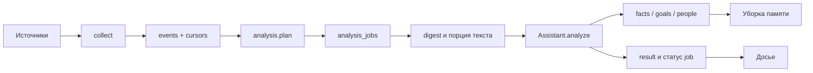

# Фоновые службы, сбор и анализ

## Службы ядра

В [`__main__._serve`](../ubermensch/__main__.py) регистрируются восемь корутин.
Они выполняются в одном event loop, а блокирующие адаптеры по необходимости
выносят I/O в потоки.

| Служба | Реализация | Период / запуск |
|---|---|---|
| Напоминания | `Core.reminder_loop` | Проверка каждые 20 секунд |
| Окно в мир | `Core.world_loop`, `world.py` | Сразу, затем каждые 3 часа |
| Импорт документов | `Core.import_loop` | Через 10 секунд, затем каждые 5 минут |
| Трекер активности | `collectors/activity.py` | Сэмпл каждые 5 секунд |
| Сбор данных | `Investigation.collect_loop` | Через 20 секунд, затем каждые 2 часа |
| Разбор данных | `Investigation.worker` | Через 90 секунд; пауза зависит от нагрузки |
| Взгляд на экран | `ScreenObserver.run` | Случайная пауза 2–4 часа перед взглядом |
| Обслуживание | `Maintenance.run` | Проверка каждые 10 минут |

[`Supervisor`](../ubermensch/services.py) перезапускает неожиданно завершившуюся
службу с backoff 5, 10, 20… до 300 секунд. После более 600 секунд успешной работы
сбрасывается backoff. Счётчик restarts остаётся накопительным для жизни процесса.
Начиная с трёх перезапусков создаётся Health-проблема; до десяти она quiet.
Успешный старт сам по себе эту проблему не очищает.

Отмена при остановке ядра передаётся службам; `CancelledError` нужно пробрасывать.
`Supervisor` не хранит задания и состояние перезапусков в БД. Разовые задачи,
созданные через `asyncio.create_task` в HTTP collect/voice/deep, не становятся
зарегистрированными службами с такой же политикой наблюдения.

## Health и шина

[`Health`](../ubermensch/health.py) хранит проблемы в памяти по ключам. Видимые
поля: key, message, since. Повторные уведомления ограничены интервалом в шесть
часов; quiet-проблема видна в состоянии, но не вызывает обычное уведомление.
Bind к event loop позволяет безопасно передать уведомление из рабочего потока.
Очистку конкретной проблемы должен вызвать владеющий ею компонент.

`Core.notify` сохраняет assistant/system сообщение и публикует notify/changed.
`Core.say` — только краткий сигнал desktop. `Bus` — очереди текущих подписчиков,
не журнал надёжной доставки. Для будущих фоновых jobs нужны отдельные durable
состояния, а не расширение объёма сообщений Bus.

## Контур расследования

`Investigation.collect()` защищён флагом `collecting`. Если сбор уже идёт,
повторный вызов возвращает пустой результат. Ошибки отдельных источников
обрабатываются локально, чтобы один недоступный аккаунт не останавливал весь обход.
События добавляются через Store, после сбора вызывается планирование.

Основное окно истории — 365 дней; для Takeout — два года. Документы, архивы чатов
с ИИ и творчество считаются медленными источниками и обходятся не чаще суток.
Категории активности и университет обновляются раз в 20 часов, стиль — раз в неделю.
Эти интервалы — константы Python, соответствующих переменных `.env` пока нет.

## Источники и их границы

| Источник / модуль | Что поступает | Состояние и особенности |
|---|---|---|
| `telegram` / `collectors/telegram.py` | Переписки личного и рабочего аккаунтов | Telethon-сессии отдельно; курсор по чату и аккаунту; лишняя групповая переписка фильтруется |
| `gmail` / `collectors/gmail.py` | Письма | Нужны адрес/пароль приложения; IMAP чтение через BODY.PEEK |
| `chrome` / `collectors/chrome.py` | История браузера из локального профиля | Копирование/чтение локальной БД, собственный курсор |
| `ai_chat` / `collectors/ai_chats.py` | Реплики владельца из локальных сессий и экспортов чатов | Отдельный путь от глубокого AI Studio импорта |
| `document` / `collectors/documents.py` | Тексты поддерживаемых документов | Личные папки (`config.PERSONAL_DIRS`: XDG «Документы», «Загрузки», «Рабочий стол», `~/Учеба`…) и `UBERMENSCH_ROOTS` |
| `creative` / `collectors/creative.py` | Признаки творческих проектов/файлов | Обход личных папок и `UBERMENSCH_ROOTS` с исключениями; не чтение всех бинарников как текста |
| `notification` / `collectors/notifications.py` | Уведомления программ и сайтов из журнала `raw/notifications`, который ядро пишет, слушая D-Bus | Только пока ядро запущено: система историю уведомлений не хранит |
| `activity` / `collectors/activity.py` | Сессии активного окна | Только с момента работы трекера |
| `youtube`, `google_search`, `google_activity` / `collectors/takeout.py` | Экспорты активности Google | Архивы и распакованные выгрузки; отдельный учёт imports |
| `lk` / `university/lk.py` | Снимки страниц личного кабинета | Сохранённая браузерная сессия, периодический снимок |

`SOURCES` содержит 12 ключей. Дополнительно очередь создаёт jobs `stats` и `person`.
Наблюдатель сохраняет события `screen`, но screen сейчас не входит в `SOURCES`
и не получает обычное помесячное планирование.

Сборщики читают реальные места пользователя: личные папки, `UBERMENSCH_ROOTS`,
`AI_CHATS_BACKUPS`, профиль Chrome `~/.config/google-chrome`, историю Claude Code
`~/.claude/projects`. Поэтому новый DATA_DIR не является sandbox источников. При переносе на другую машину сначала
проверить корни в соответствующих модулях и исключения обхода.

При добавлении источника нужен стабильный external_id. `INSERT OR IGNORE` сохраняет
первую версию события; смена текста под тем же ключом не обновляет старую запись.
Отдельно спроектировать работу с редактированием, удалением и повторным импортом.

## Планирование и размер порций

Функции [`analysis.plan`](../ubermensch/analysis.py) и `digest` находятся на уровне
модуля. Планирование выделяет периоды источников, собирает смысловые блоки через
`_units` и режет их `_pack` до 120 000 символов. Это **символы**, не токены модели;
к ним добавляются системный промпт и накопленная память.

- Обычная история группируется по месяцам, документы — по более крупному периоду.
- Незаконченный месяц анализируется один раз сразу, затем снова после завершения.
  Для activity берутся полные месяцы.
- Последние 30 дней имеют priority 2, старые периоды priority 1.
- Статистические jobs обобщают месячную активность.
- Для до 15 контактов с минимум 300 сообщениями создаётся портрет отношений за год,
  ключ привязан к кварталу, priority 0.
- Старые ключи без `@размер` используют 60 000 символов. Не начатые группы старого
  формата могут быть удалены и перепланированы; начатые сохраняют совместимость.

`digest` заново собирает данные из событий и выбирает номер порции из ключа job.
Вход не закреплён immutable snapshot: если данные изменились, содержимое границ
может измениться. Это одна из причин не масштабировать очередь несколькими
процессами без пересмотра контракта.

## Исполнение, приоритет диалога и retry

Worker получает одну pending job через Store. При пустом digest ставит skipped.
При успехе `Assistant.analyze` применяет факты/цели/людей, затем job получает
done, краткий result и число символов. Между применением памяти и завершением job
нет общей транзакции; падение в этом промежутке допускает повторный анализ.

Паузы после Claude: днём 15 минут, с 01:00 до 08:00 или после 10 минут отсутствия
пользователя — 90 секунд. Внешний цикл уступает диалогу на 10 минут после чата.
Пауза `_rest` может перерасчитываться при уходе пользователя и выполнять подходящие
задачи OpenAI; это не глобальный строгий запрет всех фоновых вызовов во время чата.

OpenAI может первично разбирать youtube/google_search/google_activity/chrome.
Разметка активности и публичные новости также имеют helper-сценарии с фильтрованным
контекстом. Личная переписка, почта и документы основного расследования идут в
Claude. Резервный чат — отдельный режим с полным контекстом, см. AI_RUNTIME.
После успешной helper-порции пауза 5 секунд.

Обработка ошибок worker:

| Ошибка | Реакция |
|---|---|
| Лимит Claude с известным reset | Ожидание до reset плюс 120 секунд, минимум 60 секунд |
| Лимит без reset | Ожидание 30 минут |
| Auth / missing | Проверка снова через 5 минут |
| Иная `BrainError` | До трёх попыток, между ними 5 минут; затем failed |
| Failed старше 12 часов | При следующем plan возвращается в pending |

Счётчики попыток хранятся в памяти Investigation, отдельного поля attempt в jobs
нет. Lock анализа в Assistant отделён от lock чата; он не ограничивает всю систему
одним сетевым запросом одновременно. При дальнейшем добавлении бюджетов и лимитов
нужен общий scheduler/учёт in-flight работы.

## Импорт: два разных пути

### Обычные файлы в `raw/import`

`Core.import_pending` перебирает файлы кроме ZIP, вычисляет SHA-256 и пропускает
только status done. Неподдерживаемые помечаются skipped, ошибка мозга — failed.
Skipped/failed пробуются на следующих проходах снова. ZIP Takeout обрабатывает
расследование, а не этот цикл.

[`ingest.py`](../ubermensch/ingest.py) читает TXT/Markdown/PDF/DOCX и AI Studio.
Обычный предел текста — 2 000 000 символов, порция — 60 000. Обычный разбор AI Studio
сокращает ответы модели до 1 500 символов как контекст; глубокий путь устроен иначе.
Наличие PDF не означает OCR сканов: полноценного распознавания изображений здесь нет.

`_patient_ask` повторяет ожидание недоступного Claude и перестраивает контекст.
Это не гарантия транзакционного продолжения любой многочастной операции:
у обычного импорта нет такого же сохранённого checkpoint по частям, как у distill.

### Глубокий AI Studio импорт

`deep_import` читает полные реплики владельца и модели, исключая isThought.
Дедупликация работает по абзацам: шинглы из пяти слов, порог совпадения 70%,
проверка длинных абзацев от 80 символов; при повторе предпочитается поздний вариант.

`Assistant.distill` сохраняет прогресс в `distill:<hash>`: обработанные части,
конспекты и изменения. После успеха конспекты сводятся и записываются в
`DOCUMENTS_DIR/Конспекты/<имя>.md`, imports становится done, курсор удаляется.
Ошибка записи конспекта логируется; это не откатывает уже применённую
память и не обязательно меняет итог импорта на failed.

Повторный ручной `/api/import/deep` может разбирать уже известный документ.
Устранение дубликатов фактов в этом случае частично опирается на контекст и модель,
а не на формальный уникальный ключ каждого извлечённого утверждения.

## Досье, стиль и уборка памяти

После каждых десяти завершённых порций со времени `consolidated_at` запускается
consolidate: обновление/скрытие дубликатов фактов и объединение людей. Эти изменения
тоже модельные и требуют проверки поведения на искусственных данных при смене промпта.

Первое досье строится после обработки свежих приоритетных данных, если есть хотя бы
одна done job. Если личный Telegram настроен, но ещё не собран, допускается ожидание
до 24 часов от старта расследования. Последующие досье — когда очередь pending
пуста и появились результаты новее последнего досье.

На вход идёт до 150 000 символов наблюдений job results. Результат сохраняется в
датированный `dossier-*.md`, `dossier/latest.md` и по возможности `~/Документы/Аня/Досье.md`.
Курсор `dossier_at` отражает успешный основной результат, а не гарантию записи копии.

Стиль обновляется раз в неделю: до 2 500 исходящих Telegram-сообщений, 35 000 символов
выборки. Для рабочего стиля нужно не менее 50 собственных сообщений. Голос persona
дополнительно использует до 40 000 символов рассуждений владельца из разговоров с ИИ.
`/api/voice` запускает обновление явно. Это генерация текстовых инструкций, не обучение
или fine-tuning модели.

## Активность и экран

Трекер каждые 5 секунд смотрит активное окно (от скрипта KWin) и простой (Wayland
ext-idle-notify, шаг 5 секунд) — см. `system/session.py`. Простой больше
120 секунд не считается; сохраняются сессии от 10 секунд. Пропуск замеров более
60 секунд завершает сессию по предыдущему замеру, чтобы сон компьютера не считался
активной работой. Незакрытая сессия живёт в памяти до смены окна/состояния.

Наблюдатель экрана активен с 09:00 до 01:00, только при idle не больше 120 секунд.
Проверяются активное приложение/заголовок и полноэкранный режим. Снимок основного
экрана ограничивается по размеру и передаётся Claude Read. `screens/now.jpg`
удаляется в finally; в events остаётся краткое activity с source screen, комментарий
публикуется через say. Ручной tool screenshot использует **другой** `request.jpg`,
который автоматически после вызова не удаляется.

Проверка заголовка не видит все окна/уведомления/секреты на изображении; она снижает
риск, но не гарантирует приватность каждого снимка. Политика — в SECURITY.

## Внешние интеграции

- **Почта:** отдельные IMAP-сбор и SMTP-отправка; отправка из инструмента проходит
  Core approval. Наличие доступа для чтения не означает автоматическую отправку.
- **Календарь:** OAuth client и token в secrets, обновление токена по необходимости,
  primary calendar. Удаление чужого события требует подтверждения; ownership
  определяется текстовым маркером в description.
- **Вуз:** публичный сайт `mospolytech.ru`; кабинет `e.mospolytech.ru/old` через
  Playwright/Chrome. Сессия в secrets, снимок в raw/lk. Обход ограничен страницами
  и задержками, опасные ссылки фильтруются эвристикой. Это адаптер чтения, не
  универсальная доказанная sandbox-защита любого веб-приложения.
- **Мир:** Open-Meteo, курсы open.er-api.com, RSS Google News. Кеш world.json;
  при формировании контекста данные старше суток не считаются актуальными.

## Резервные копии и диск

Maintenance проверяет диск каждые 10 минут. При остатке меньше 5 GB сообщает
проблему; принудительной остановки записи или очистки пользовательских данных нет.
Архив создаётся, если предыдущего нет, ему больше 36 часов либо больше 20 часов
и локальное время между 02:00 и 06:00.

SQLite snapshot создаётся через `Connection.backup`, затем 7-Zip (`7z`, пароль через
stdin) шифрует архив и имена файлов. Сохраняются 7 локальных архивов, на найденном
внешнем носителе — 14. Носители ищутся в `/media/<пользователь>`, `/run/media/<пользователь>`
и `/mnt` (кроме устройства с самой папкой данных) по маркеру `AnyaBackup` либо старому `OswaldBackup`.
Если внешней копии давно нет, появляется предупреждение; порог — семь дней.

Состав архива ограничен, точный список включений/исключений — в
[DATA_MODEL](DATA_MODEL.md). Смена DATA_DIR не делает алгоритм поиска внешнего
носителя полностью переносимым: исключение букв C/D пока жёсткое.
