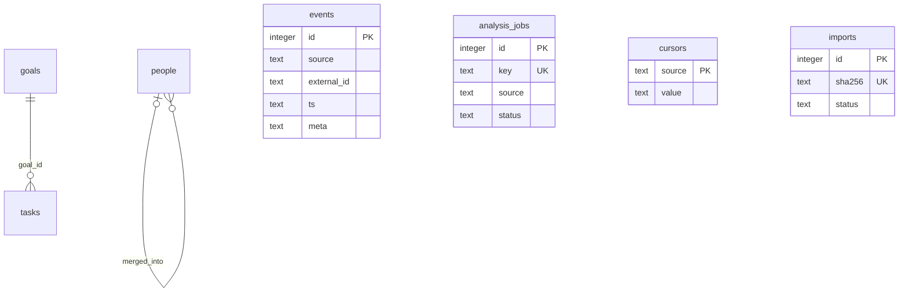

# Данные, SQLite и файловые хранилища

## Кто владеет данными

[`Store`](../ubermensch/store.py) — основной слой доступа к предметной SQLite-базе.
Его создаёт ядро. UI получает снимки через HTTP, сборщики возвращают события ядру,
Assistant применяет структурированные операции через методы Store. Backup использует
отдельное SQLite-подключение и штатный механизм snapshot.

По умолчанию БД: `~/Projects/Ubermensch/db/ubermensch.db` (`DATA_DIR/db`). Включён `journal_mode=WAL`,
поэтому рядом могут существовать `ubermensch.db-wal` и `ubermensch.db-shm`.
Наличие WAL нормально. Нельзя копировать только живой `.db` и считать это
согласованной резервной копией всех последних изменений.

Connection создаётся с `isolation_level=None`: большинство операций — отдельные
autocommit-транзакции. Пакетная вставка событий и миграции используют явные
транзакции. Сохранение целого ответа ИИ общей транзакцией не охвачено.
Connection привязан к потоку; отдельного публичного `Store.close()` пока нет,
тесты закрывают `store.db.close()`.

## Схема и миграции

Текущая схема: **12 прикладных таблиц, `PRAGMA user_version=6`**.

| Версия | Изменения |
|---|---|
| 1 | `messages`, `facts`, `goals`, `reminders`, `actions`; индекс напоминаний |
| 2 | Канал и notes сообщений; `tasks` и индекс задач |
| 3 | `imports` |
| 4 | `events`, `cursors`, `analysis_jobs`, `people`; индекс событий |
| 5 | `people.merged_into` |
| 6 | `activity_categories` |

Store читает `user_version`, затем применяет оставшиеся элементы списка
`MIGRATIONS` по порядку. Каждый элемент выполняется как `BEGIN; ...;
PRAGMA user_version=N; COMMIT;`. Старые элементы нельзя менять: установленная
база их повторно не выполнит. Автоматического downgrade и явного отказа при
версии базы новее кода пока нет.



Связи `goal_id` и `merged_into` объявлены в SQL, но `PRAGMA foreign_keys=ON`
в Store не выполняется. Поэтому наличие `REFERENCES` сейчас не гарантирует
проверку ссылочной целостности. Связь events/jobs/cursors — программная по строкам,
SQL foreign key между ними нет.

В таблицах ниже `?` означает nullable. ID — `INTEGER PRIMARY KEY`, если не указано
иначе. Время хранится текстом; `created_at`, `updated_at` и `ts` не являются
специальными SQLite-типами времени.

## Диалог, память и цели

### `messages`

| Поля | Тип / смысл |
|---|---|
| `id` | ID сообщения |
| `ts` | TEXT NOT NULL, локальное время до секунд |
| `role` | TEXT, CHECK `user` / `assistant` |
| `text` | TEXT NOT NULL |
| `channel` | TEXT NOT NULL DEFAULT `tg`; также `desktop`, `system` по сценариям |
| `notes` | TEXT ?, JSON-массив служебных строк |

`recent_messages(limit)` выбирает последние по ID и возвращает в хронологическом
порядке. Диалог общий для каналов. `notify()` сохраняет сообщение assistant с каналом
system; `say()` публикует только временный сигнал. Вызовы инструментов не хранятся
здесь как полная трасса model/tool messages.

### `facts`

`id`, `area TEXT`, `content TEXT`, `importance INTEGER DEFAULT 3`, `source TEXT`,
`active INTEGER DEFAULT 1`, `created_at TEXT`, `updated_at TEXT`; все NOT NULL.

`forget_fact` делает `active=0`: это мягкое скрытие, не физическое удаление.
`facts(limit)` возвращает активные записи по importance DESC, updated_at DESC.
История предыдущих редакций content отдельно не сохраняется.

### `goals`

`id`, `area TEXT`, `title TEXT`, `details TEXT DEFAULT ''`, `deadline TEXT ?`,
`status TEXT DEFAULT active`, `created_at TEXT`, `updated_at TEXT`.
Все поля, кроме deadline, NOT NULL; CHECK status: `active`, `done`, `dropped`.

`update_goal` и `set_goal_status` меняют только активные цели. Дедлайны — строки;
общего строгого формата/часового пояса на уровне БД нет.

### `tasks`

`id`, `title TEXT`, `notes TEXT DEFAULT ''`, `goal_id INTEGER ?`, `due TEXT ?`,
`status TEXT DEFAULT open`, `source TEXT`, `created_at TEXT`, `done_at TEXT ?`.
NOT NULL, кроме трёх полей с `?`. CHECK status: `open`, `done`, `dropped`.
Индекс `tasks_status(status, due)`.

`tasks()` возвращает open и done с `done_at >= сегодняшней дате`. Завершение ставит
`done_at=now()`, возврат в open или dropped очищает done_at. Через обычный update
можно менять title/notes/due, но нельзя переназначить goal_id.

Многие update-методы используют SQL `COALESCE(?, old_value)`. `None` означает
«оставить прежнее», поэтому этим интерфейсом нельзя очистить nullable-поле до NULL.
Assistant дополнительно нормализует часть пустых строк в None. Новому интерфейсу
редактирования потребуется отличать «не передано» от «очистить».

### `people`

`id`, `name TEXT`, `relation TEXT DEFAULT ''`, `notes TEXT DEFAULT ''`,
`importance INTEGER DEFAULT 3`, `updated_at TEXT`, `merged_into INTEGER ?`.
Все кроме merged_into NOT NULL.

`people(limit)` скрывает merged-записи. `merge_person(id, into_id)` не переносит
notes автоматически: сначала нужно обновить основную запись, затем скрыть дубль.
Проверяется, что цель существует, не merged и не равна исходной записи. Это
операция объединения карточек, а не удаления первичных событий с человеком.

### Сферы памяти

`AREAS` задаёт семь ключей: `profile`, `career`, `health`, `learning`, `discipline`,
`personal`, `growth`. Русские подписи используются в UI и метриках. SQLite не
накладывает CHECK на `area`; допустимость ключей задают модельные схемы и код.

## Напоминания и действия

### `reminders`

`id`, `due_at TEXT`, `text TEXT`, `status TEXT DEFAULT pending`, `created_at TEXT`;
все NOT NULL. CHECK: `pending`, `sent`, `cancelled`.
Индекс `reminders_due(status, due_at)`.

Выборка готовых напоминаний сравнивает строки `due_at <= now()`. Цикл отмечает
напоминание sent **до** публикации в Bus. Статус sent означает, что ядро передало
сигнал, а не подтвердило получение Telegram или desktop. Ретраев доставки нет.

### `actions`

`id`, `kind TEXT`, `summary TEXT`, `params TEXT`, `risk TEXT`, `status TEXT`,
`result TEXT ?`, `created_at TEXT`, `decided_at TEXT ?`. Остальные NOT NULL.
`params` — JSON-объект. CHECK status: `pending`, `approved`, `rejected`, `done`, `failed`.

В таблице сосуществуют два механизма:

- Структурированные действия `actions.py`, например напоминание, проходят собственное
  применение и могут завершаться done/failed.
- `Core.request_approval` создаёт `kind=approval`, сохраняет детали и ждёт Future
  в оперативной памяти. approved/rejected здесь фиксируют **решение**, а не
  доказанный результат внешнего инструмента.

`decide_action` обновляет только pending, что защищает от двойного решения.
После перезапуска Future отсутствует, но строка pending может сохраниться.
Механизма возобновления такого инструмента нет; нельзя по строке approval
автоматически восстанавливать отправку сообщения.

## Сырые события и очередь

### `events`

| Поля | Смысл |
|---|---|
| `id INTEGER PK` | Локальный ID |
| `source TEXT NOT NULL` | Источник, например telegram или document |
| `external_id TEXT NOT NULL` | Стабильный ID внутри источника |
| `ts TEXT NOT NULL` | Время события |
| `thread TEXT ?` | Чат, поток, программа или другая группировка |
| `author TEXT ?` | Автор при наличии |
| `outgoing INTEGER NOT NULL DEFAULT 0` | Реплика/действие владельца |
| `text TEXT NOT NULL` | Текст для анализа |
| `meta TEXT ?` | JSON-объект со специфичными полями |

UNIQUE `(source, external_id)`, индекс `events_source_ts(source, ts)`.
`add_events` выполняет пакетный `INSERT OR IGNORE`. Повторная запись с тем же ключом
не обновляет текст, время и meta. Поэтому политика обработки редактирования
исходного сообщения должна проектироваться отдельно.

Пример входа сборщика:

```json
{
  "source": "document",
  "external_id": "fixture:example:1",
  "ts": "2026-10-15T12:00:00",
  "thread": "example.txt",
  "author": null,
  "outgoing": 0,
  "text": "Искусственный документ для проверки парсера",
  "meta": {"fixture": true}
}
```

Store сериализует meta сам; не передавать туда уже сериализованную JSON-строку.
Методы выборки используют полуинтервал `[start, end)` и сортировку `ts, id`.
Для activity длительность хранится в `meta.seconds`; для Telegram meta содержит
тип чата и при необходимости account. Старые личные Telegram-события могут не
иметь account — код трактует их как personal.

### `analysis_jobs`

`id`, `key TEXT UNIQUE`, `source TEXT`, `title TEXT`, `period_start TEXT`,
`period_end TEXT`, `priority INTEGER DEFAULT 0`, `status TEXT DEFAULT pending`,
`chars INTEGER ?`, `result TEXT ?`, `created_at TEXT`, `done_at TEXT ?`.
Остальные NOT NULL. CHECK status: `pending`, `done`, `failed`, `skipped`.

`key` кодирует единицу планирования и её часть; современные ключи включают размер
порции через `@120000`. Старые ключи обрабатываются совместимым кодом. Не менять
алгоритм ключей без плана для существующей очереди.

`next_job` выбирает pending по priority DESC, затем периоду и ID. Он не переводит
строку в running и не захватывает lease. Поэтому гарантируется только сценарий
с одним исполнителем внутри текущего ядра. Порции заново строятся из events;
отдельного неизменяемого snapshot входа каждой job нет.

### `imports`

`id`, `name TEXT`, `sha256 TEXT UNIQUE`, `status TEXT`, `summary TEXT ?`,
`imported_at TEXT`. Остальные NOT NULL. CHECK status: `done`, `skipped`, `failed`.

Для обычных документов sha256 — хеш байтов. Некоторые сборщики используют это
поле как общий ключ учёта, например с префиксами `takeout:` и `aiexport:`. Нельзя
полагать, что всякая строка здесь — ровно 64 hex-символа.

Обычный импорт пропускает только done. Failed и skipped пробуются снова; параметр
`retry_failed` текущего `import_pending` не управляет этим поведением.
Успешная запись summary не является копией исходного документа.

### `cursors`

`source TEXT PRIMARY KEY`, `value TEXT NOT NULL`, `updated_at TEXT NOT NULL`.
Это общее key-value-хранилище прогресса, не только курсоры источников.

| Ключ / семейство | Формат и смысл |
|---|---|
| `chrome`, `gmail` | Положение сбора; формат определяется соответствующим адаптером |
| `telegram:<chat>`, `telegram:work:<chat>` | ID последнего сообщения по аккаунту/чату |
| `collected:<source>` | Время последнего запуска соответствующего обхода/обновления |
| `investigation_started` | Начало расследования, в том числе ожидание первого Telegram-сбора |
| `dossier_at`, `consolidated_at` | Время досье и уборки памяти |
| `distill:<sha256>` | JSON с `done`, `notes`, `changes` для продолжения глубокого импорта |
| `university:news` | JSON известных ссылок новостей, ограниченная история |
| `openai:spent` | Накопленная расчётная стоимость |
| `openai:model:background`, `openai:model:chat` | Кеш выбора модели по роли |

Обновление выполняется UPSERT. При добавлении ключа документировать владельца,
формат и смысл удаления. Удаление курсора источника может повторно запустить
дорогой сбор; удаление `openai:spent` сбросит локальный учёт расходов.

### `activity_categories`

`key TEXT PRIMARY KEY`, `category TEXT NOT NULL`, `updated_at TEXT NOT NULL`.
Ключ строится `metrics.activity_key` из программы/заголовка, категория определяется
разметкой ИИ. CHECK категорий в SQL нет; интерпретация известных значений находится
в `metrics.CATEGORIES`.

## Время и идентификаторы

`store.now()` — локальный `datetime.now().isoformat(timespec='seconds')` без
UTC-offset. Часть интеграций преобразует внешние даты в локальные строки, а контекст
модели содержит текущий offset. Унифицированного UTC-контракта пока нет.

Для текущей машины важно сохранять одинаковый формат сортируемых строк. Для
нескольких устройств нужен явный переход: UTC для времени событий и отдельный
timezone для пользовательских сроков. Смешивание aware/naive строк без миграции
может испортить сравнение напоминаний и границы суточных метрик.

SQLite ID локален для одной БД. UUID `run_id` инструмента не связан с первичными
ключами таблиц и не является ключом дедупликации. `source` факта/задачи —
происхождение записи, а не надёжная модель авторизации или версия устройства.

## Файловая карта установленной системы

Пути ниже подтверждены по структуре каталогов; личное содержимое для подготовки
документации не использовалось.

```text
~/Projects/Ubermensch/        DATA_DIR (права 700)
  db/ubermensch.db            основная SQLite-база (+ WAL/SHM во время работы)
  secrets/                    API-токен, Telegram-сессии, OAuth, сессия ЛК (права 700)
  raw/import/                 входящие файлы и экспорты
  raw/lk/snapshot.json        снимок личного кабинета
  raw/notifications/          уведомления с D-Bus по дням (ГГГГ-ММ-ДД.jsonl, 30 дней)
  workspace/
    mcp.json                  генерируемая конфигурация MCP
    system_prompt*.md         генерируемые промпты
    anya_persona.md           голос помощника
    tg_style.md               личный стиль переписки
    tg_style_work.md          рабочий стиль переписки
    world.json                кеш погоды, валют, новостей
    screens/                  автоматические/запрошенные снимки
    runs/<uuid>/tools.jsonl   минимальный журнал инструментов
  dossier/                    датированные досье и latest.md
  backups/                    локальные архивы
  logs/                       журналы
  ubermensch.lock             блокировка одного ядра для этого DATA_DIR
  personalization/
    current.json              указатель на опубликованную версию профиля
    versions/<id>/            profile.json, profile.md, manifest.json (неизменяемы)
    corpus/<время>/           последний снимок для профиля: snapshot.db, evidence.sqlite
    map/<sha256>.json         кеш наблюдений по окнам

~/Документы/Аня/              ANYA_DOCUMENTS: заметки, Конспекты/, Досье.md, Word/Excel
DIARY_DIR                     дневник пользователя в Obsidian (если задан), только чтение
```

Дневник — отдельное хранилище пользователя. Он не становится частью `DATA_DIR`,
мозг получает его только на чтение (`--add-dir`), запись в него не входит в
свободные зоны. Приложение не синхронизирует vault и не управляет `.obsidian`.

`workspace/runs` хранит только имя и статус инструмента, без аргументов, результата,
времени и идентификатора отдельного вызова. Это защита от опасного автоматического
повтора, а не полный аудит или очередь продолжения. Автоматической очистки старых
непустых run-каталогов сейчас нет.

## Что действительно резервируется

[`maintenance.py`](../ubermensch/maintenance.py) делает SQLite snapshot и включает
в архив:

- Базу.
- `workspace/tg_style.md` и `workspace/anya_persona.md`, если существуют.
- Каталог `dossier`.

**Не включены:** `personalization` (профиль перестраивается из базы), дневник, `~/Документы/Аня`, `raw/import`, `raw/notifications`, сессии и OAuth
из `secrets`, `.env`, рабочий стиль `tg_style_work.md`, остальные файлы workspace.
Это существенная граница восстановления: архив приложения не равен полной копии
всех данных владельца и всех исходников анализа.

Код проверяет наличие свободного места и создаёт зашифрованные архивы, но не
шифрует папку данных и не проверяет шифрование диска (см. [SECURITY](SECURITY.md#хранение-на-диске)). Параметры ротации, внешние носители
и пошаговое восстановление описаны в [OPERATIONS](OPERATIONS.md). Перед восстановлением
нужно остановить процесс, работающий с этой базой, сохранить текущий комплект данных
и отдельно решить судьбу WAL/SHM; нельзя подменять `.db` под работающим Core.

## Проверка схемы без личных данных

Из корня проекта:

```bash
.venv/bin/python -c "from ubermensch.store import Store; s=Store(':memory:'); print(s.db.execute('PRAGMA user_version').fetchone()[0]); s.db.close()"
```

Ожидается `6`. Для изменения миграций создать искусственную БД предыдущей версии,
проверить сохранность строк после открытия новым Store, затем повторно открыть её.
Не тестировать миграцию впервые на рабочей `DATA_DIR/db/ubermensch.db`.
