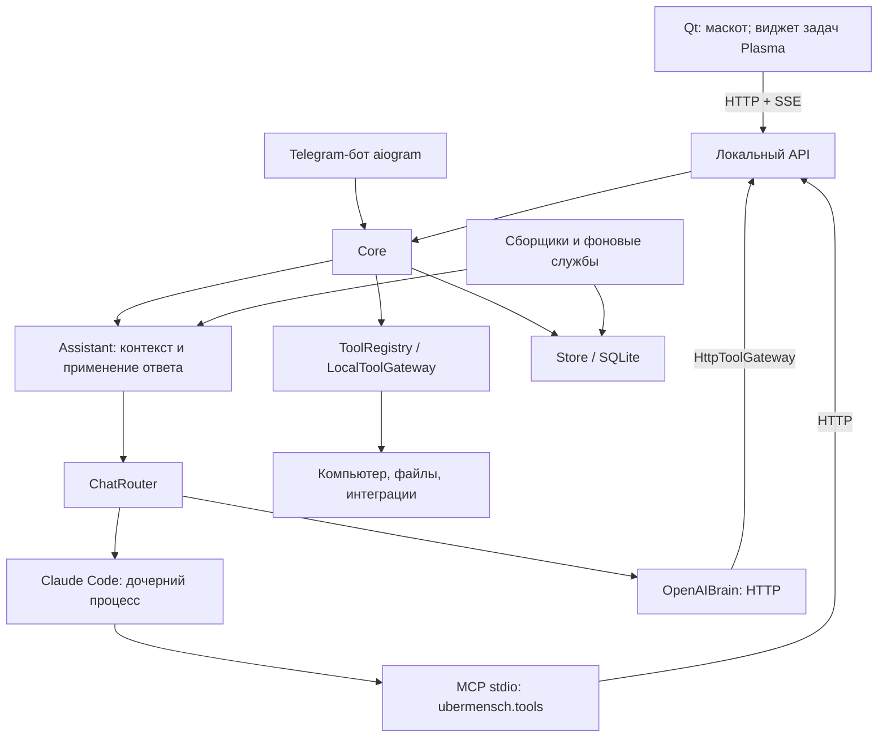

# Руководство разработчика

## 1. Назначение и текущее состояние

Система соединяет диалог, долговременную память, задачи, напоминания, действия на
компьютере и фоновое изучение данных владельца. Два пользовательских входа —
настольный интерфейс (KDE Plasma) и Telegram-бот. Главный ИИ вызывается через Claude Code CLI;
опциональный OpenAI API выполняет часть фонового разбора и продолжает чат при
недоступности Claude.

Главный архитектурный принцип текущего этапа: **провайдер выбирает инструмент,
а код приложения определяет его исполнение и подтверждение**. Каталог общих
возможностей един для MCP и HTTP. Это уже реализовано. Отдельный агент устройства,
удалённые устройства, устойчивые задания и общий протокол провайдеров — дальнейшая
работа, а не существующая инфраструктура.

Приложение не является многопользовательским сервером: в таблицах нет `user_id`,
доступ к локальному API даёт один bearer-токен, настройки относятся к одному
владельцу. Для нескольких личных устройств сначала нужен контракт устройств;
вводить организации и арендаторов без продуктовой необходимости не требуется.

## 2. Процессы и зависимости



Основное ядро — один `asyncio`-процесс. Telegram-бот живёт в нём же. Qt не работает
в его event loop: desktop supervisor запускает отдельные процессы маскота и листа.
Claude CLI и MCP-сервер — дополнительные дочерние процессы на время работы ИИ.

Файловые и сетевые блокирующие операции часто вынесены через `asyncio.to_thread`.
SQLite остаётся синхронным и привязанным к потоку создания `Store`. Нельзя просто
перенести метод `store.*` в `to_thread`: нужен собственный connection или другой
контракт доступа. Некоторые короткие файловые операции пока выполняются прямо
в event loop; это технический долг, а не образец для тяжёлых обработчиков.

## 3. Карта исходников

Все пути в таблице относительны к `ubermensch/`.

| Файл / каталог | Ответственность | Чего здесь не размещать |
|---|---|---|
| [`__main__.py`](../ubermensch/__main__.py) | Сборка объектов, запуск API, служб и бота, ожидание диска, lock процесса | Предметные правила задач и памяти |
| [`config.py`](../ubermensch/config.py) | Пути, окружение, поиск Claude, токен API, свободные и защищённые зоны | Логику конкретных пользовательских действий |
| [`core.py`](../ubermensch/core.py) | Координация, состояние, шина, подтверждения, общие инструменты, Telegram-сессии | Код рисования и модельные HTTP-пакеты |
| [`api.py`](../ubermensch/api.py) | HTTP/SSE-адаптер над Core, проверка токена, сериализация | Прямой SQL и обход политик действий |
| [`assistant.py`](../ubermensch/assistant.py) | Контекст, промпты, схема ответа, применение памяти/целей/задач, анализ | Прямую отправку сообщений от лица владельца |
| [`brain.py`](../ubermensch/brain.py) | Claude CLI, `Answer`, `BrainError`, остановка дерева процесса | Каталог системных возможностей |
| [`openai_brain.py`](../ubermensch/openai_brain.py) | Запросы OpenAI, выбор модели, бюджет, цикл вызова функций | Дублирующие реализации файловых и системных операций |
| [`runtime/`](../ubermensch/runtime/) | Маршрутизация чата, шлюзы инструментов, журнал попытки | UI и содержимое личной памяти |
| [`capabilities/`](../ubermensch/capabilities/) | Общий реестр, схемы аргументов, функции и правила подтверждений | Протокол конкретного ИИ |
| [`tools.py`](../ubermensch/tools.py) | Тонкий MCP-адаптер над общим HTTP API | Самостоятельное исполнение альтернативной версии инструментов |
| [`store.py`](../ubermensch/store.py) | SQLite, миграции, выборки, курсоры | Вызовы внешнего ИИ |
| [`actions.py`](../ubermensch/actions.py) | Старый механизм структурированных действий; сейчас напоминания | Второй параллельный каталог общих системных инструментов |
| [`analysis.py`](../ubermensch/analysis.py) | Сбор, планирование и обработка истории, стиль, досье | Логику отображения прогресса |
| [`profiling.py`](../ubermensch/profiling.py), [`behavior.py`](../ubermensch/behavior.py) | Построение профиля, метрики поведения | Прямые изменения памяти (facts/people) |
| [`collectors/`](../ubermensch/collectors/) | Адаптеры источников и сбор активности | Применение модельного вывода к памяти |
| [`ingest.py`](../ubermensch/ingest.py) | Чтение и разбиение документов/экспортов | Сетевую доставку уведомлений |
| [`system/`](../ubermensch/system/) | Сенсоры сеанса (KWin, Wayland, D-Bus), bash, файлы, Office, снимки | Решения провайдера о необходимости действия |
| [`university/`](../ubermensch/university/) | Публичный сайт и личный кабинет вуза | Универсальный обход произвольных личных кабинетов |
| [`google_calendar.py`](../ubermensch/google_calendar.py), [`mail.py`](../ubermensch/mail.py) | Клиенты внешних интеграций | UI-подтверждения |
| [`world.py`](../ubermensch/world.py) | Погода, валюты, новости, локальный кеш | Долговременную память владельца |
| [`observer.py`](../ubermensch/observer.py) | Периодический взгляд на экран | Постоянную запись видео |
| [`services.py`](../ubermensch/services.py), [`health.py`](../ubermensch/health.py) | Надзор служб, состояние неисправностей | Устойчивую распределённую очередь заданий |
| [`maintenance.py`](../ubermensch/maintenance.py) | Проверка диска и резервные копии | Автоматическое восстановление поверх живой БД |
| [`metrics.py`](../ubermensch/metrics.py) | Вычисление показателей для UI | Сохранение независимой копии предметных данных |
| [`bot.py`](../ubermensch/bot.py) | Команды, сообщения, кнопки Telegram и доставка событий | Собственную реализацию памяти |
| [`desktop/`](../ubermensch/desktop/) | Qt, HTTP/SSE-клиент, окна, локальная связь процессов | Прямой доступ к SQLite |
| [`prompts/`](../ubermensch/prompts/) | Шаблоны инструкций модели | Пароли и изменяемое состояние приложения |

## 4. Сквозные сценарии

### Сообщение пользователя

1. HTTP `/api/chat` или обработчик Telegram вызывает `Core.chat(text, channel)`.
2. Core отмечает активность диалога и увеличивает счётчик занятости мозга.
3. `Assistant.handle` получает общий lock диалога, строит контекст и записывает
   пользовательское сообщение. Desktop и Telegram используют одну память и этот lock.
4. `ChatRouter` запускает Claude; при допустимых условиях передаёт запрос OpenAI.
5. Вызовы инструментов проходят через локальный API и общий реестр. Подтверждение
   может приостановить инструмент до решения владельца.
6. Assistant сохраняет ответ и последовательно применяет операции над памятью,
   целями, задачами, людьми и структурированными действиями.
7. Core публикует обновление состояния; UI повторно запрашивает `/api/state`.

Шаг 6 не является одной транзакцией. Ошибка в середине может оставить часть изменений
применённой. Текст ответа сохраняется до завершения всех предметных операций.

### Инструмент с подтверждением

Модель вызывает `telegram_send` → gateway вызывает `/api/tools/call` → capability
обращается к внутреннему `/api/tg/send` → `Core.send_telegram` создаёт approval →
пользователь отвечает через UI или Telegram → `Core.decide` завершает ожидающий
Future → отправка выполняется или возвращается отказ.

Внутренний HTTP-переход capability → Core пока сохранён для совместимости старых
интеграций. Реестр уже общий, но это ещё не полностью внедряемые через зависимости
сервисы. При следующем разделении нужно заменить этот переход явным контекстом
исполнения, сохранив проверки и тесты.

### Фоновое изучение

Сборщик получает записи → `Store.add_events` устраняет дубликаты → `analysis.plan`
создаёт `analysis_jobs` → один worker формирует порцию текста → Assistant вызывает ИИ
без инструментов → применяет факты/цели/людей → job получает итоговый статус → позже
строятся досье и стиль. Это отдельный контур от текущего диалога.

## 5. Правила изменения архитектуры

- Сохранять одну реализацию системного действия для обоих ИИ. Разница между
  провайдерами относится к формату запроса и ответа, а не к правам действия.
- Подтверждение выполнять в коде. Фраза в промпте не заменяет проверку перед эффектом.
- Не повторять автоматически действие с неопределённым результатом. Потеря HTTP-ответа
  после отправки сообщения не означает, что сообщение не отправлено.
- Не открывать SQLite из desktop. Новый клиент получает данные через API.
- Не менять старые миграции. Добавлять следующую, сохранять существующие данные.
- Не считать шину `Bus` журналом событий: это временные сигналы обновления UI.
- Не добавлять второго analysis worker до появления атомарного захвата задания.
- Не привязывать новый сборщик к конкретным путям в коде. Брать корни из
  `config.PERSONAL_DIRS`/`EXTRA_ROOTS` или выделять их в конфигурацию.

## 6. Рецепты расширения

### Добавить системный инструмент

1. Выбрать модуль в `capabilities/` или создать предметный модуль и импортировать
   его в `load_registry()`.
2. Добавить `async def` с аннотациями, понятным docstring и `@registry.tool()`.
   Сигнатура становится JSON Schema; дополнительные поля аргументов запрещены.
3. До побочного эффекта проверить путь, получателя и необходимость подтверждения.
   Блокирующий I/O перенести в `to_thread` без передачи туда основного Store.
4. Возвращать JSON-совместимый результат. Для ожидаемого отказа дать понятный ответ;
   для неопределённого эффекта не создавать автоматический retry.
5. Проверить совпадение каталога MCP/HTTP, валидные/невалидные аргументы, отказ
   пользователя и вызов через резервного ИИ. Обновить AI_RUNTIME и SECURITY.

Пример инструмента без побочных эффектов:

```python
from .registry import registry

@registry.tool()
async def echo_text(text: str) -> dict:
    """Вернуть переданный текст для диагностики подключения инструмента."""
    return {"text": text}
```

Это пример расширения, в текущий каталог `echo_text` не входит. Не добавлять
параллельно ручную JSON-схему в OpenAI: она должна происходить из реестра.

### Добавить HTTP-операцию

Разместить предметное действие в Core/сервисе, адаптер — в `api.create_app`.
Определить типы, валидацию, ошибки и повторяемость до реализации клиента. Публиковать
`changed` после изменения состояния. Обновить API и интеграционный тест с настоящим
локальным aiohttp-сервером. Не копировать слабую валидацию старых маршрутов как норму.

### Добавить данные и миграцию

Добавить SQL в конец `MIGRATIONS`, методы в Store, затем операции Assistant/API.
Проверить миграцию с предыдущей версии на искусственных данных и повторное открытие
без повторной миграции. Учесть `NULL`, индексы выборок, размер истории и удаление.
Включение `foreign_keys` требует отдельной проверки существующих ссылок.

### Добавить источник

Сборщик должен возвращать стабильный `(source, external_id)`, локальную метку
времени принятого формата, текст и `meta`. Зафиксировать алгоритм курсора, область
обхода, лимиты и поведение повторного запуска. Подключить источник к сбору,
планированию и метрикам; решить отдельно, допустим ли для него фоновый OpenAI.
Сначала проверить парсер на синтетическом экспорте без аккаунта пользователя.

### Добавить другого провайдера ИИ

Ориентироваться на `Answer`/`BrainError` и схему Assistant, но учитывать, что полного
универсального интерфейса провайдеров пока нет. Адаптер должен поддерживать общий
gateway, прекращать цикл при неопределённом результате, учитывать расход каждого
хода, ограничивать количество вызовов и отменять свою работу. Только текстовая
генерация без инструментов не эквивалентна резервному чату.

### Изменить промпт

Редактировать шаблоны `ubermensch/prompts/*.md`; файлы `workspace/system_prompt*.md`
генерируются. Проверить согласованность промпта со схемой и реальным каталогом.
Изменение промпта не должно расширять права исполнителя. Для данных из документов
сохранять явное отделение данных от инструкций.

## 7. Перед передачей изменения

Из описания изменения должно быть понятно: какой сценарий был сломан, как он теперь
работает, какие данные затронуты и чем это проверено. Не обещать проверку живого ИИ,
доставки Telegram или восстановления бэкапа, если использовались только заглушки.
Минимальный набор команд и матрица проверок приведены в [TESTING](TESTING.md).

Следующий крупный архитектурный этап разумно начинать с устойчивого состояния
исполнения и устройств, сохраняя рабочие интерфейсы. Подробный порядок — в
[EVOLUTION](EVOLUTION.md); список конкретных текущих пробелов — в
[LIMITATIONS](LIMITATIONS.md).

