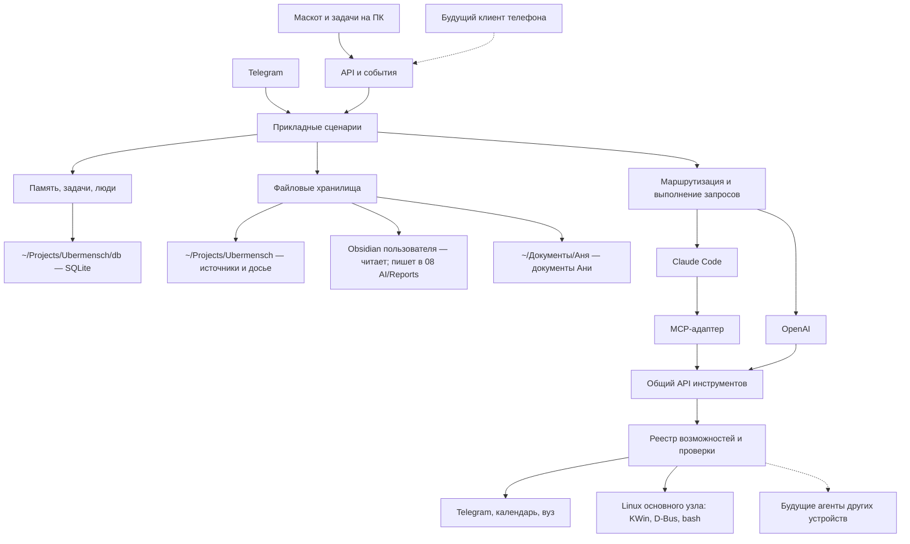

# Развитие архитектуры: личный помощник на нескольких устройствах

Обновление 23 октября 2026: сохраняемые runs/calls/approvals, outbox, транзакции,
права фонового агента и восстановление описаны в [RELIABILITY](RELIABILITY.md).
Поручение, прерванное при выполнении, требует проверки и нового явного продолжения;
автоматического повтора после рестарта нет.

Точное текущее поведение описано в [руководстве разработчика](DEVELOPMENT.md),
[контрактах API](API.md) и [ИИ-runtime](AI_RUNTIME.md). Проверяемые критерии
следующих изменений собраны в [LIMITATIONS](LIMITATIONS.md).

## Направление

Один владелец, один основной узел с памятью, несколько клиентских устройств.
Основной узел сейчас — ноутбук с Linux (KDE Plasma, Wayland); до октября 2026 года им был Windows-ПК. Telegram, маскот и будущий телефон пользуются
одними сценариями работы и одним механизмом подтверждений. Смена модели ИИ не должна
отключать работу с файлами, календарём или перепиской.

Основа — модульный монолит с отдельными процессами интерфейса и агентами устройств.
Выносить сервис в отдельный процесс нужно, когда появилась измеримая причина:
блокировка чата фоновой работой, отдельный жизненный цикл или другое устройство.
Несколько пользователей, микросервисы и распределённая база сейчас не требуются.

Пунктиром обозначены будущие части. API пока слушает только `127.0.0.1`;
удалённое подключение телефона ещё не реализовано.

## Существующие хранилища

Код проекта находится в `~/Projects/Übermensch_Project`, а рабочие данные живут отдельно, в соседней папке. Эти данные входят
в архитектуру основного узла и сохраняются при разделении модулей. Проверена структура
папок; содержимое личных заметок, переписок и секретов для этой инвентаризации не читалось.

| Место | Назначение | Как учитывать при развитии |
|---|---|---|
| `~/Projects/Ubermensch/db/ubermensch.db` | Основная SQLite-база памяти, задач, истории и собранных событий | Сохранять существующую базу; изменения схемы проводить миграциями |
| `~/Projects/Ubermensch/raw/import` | Входящие документы и архивы для обработки | Сохранять происхождение данных и состояние импорта |
| `~/Projects/Ubermensch/raw/notifications` | Уведомления, услышанные на D-Bus | Срок хранения 30 дней; это сырой источник, не история |
| `~/Projects/Ubermensch/dossier` | Досье и его версии | Связывать результат с источниками и временем построения |
| `~/Projects/Ubermensch/workspace` | Персона, стили переписки, сгенерированные промпты, служебные файлы | Различать сохраняемое состояние и восстанавливаемый кэш: вся папка не является временной |
| `~/Projects/Ubermensch/secrets` | Сессии интеграций и токены доступа | Обслуживать на основном узле через соответствующие интеграции |
| `~/Projects/Ubermensch/logs` | Журналы работы | Использовать для диагностики и ограничивать срок хранения |
| `~/Projects/Ubermensch/backups` | Локальные архивы резервного копирования | Проверять состав и восстановление отдельно от работоспособности приложения |
| `OBSIDIAN_VAULT` | Хранилище Obsidian пользователя: дневник, ориентиры, проекты | Пользовательское хранилище: чтение, запись только в `08 AI/Reports` |
| `~/Документы/Аня` | Word, Excel и другие документы Ани | Учитывать как отдельное место хранения результатов |

Корни задаются настройками `UBERMENSCH_DATA`, `OBSIDIAN_VAULT`, `ANYA_DOCUMENTS`, `UBERMENSCH_ROOTS`. В целевом интерфейсе хранения
клиент использует идентификатор хранилища и относительный путь, а основной узел
определяет локальный путь. Телефону не требуется воспроизводить пути основного узла.
Такой интерфейс ещё предстоит реализовать; текущие файловые инструменты принимают пути.

Репозитории памяти владеют таблицами SQLite, файловый сервис — документами и артефактами,
чтение дневника — хранилищем пользователя. Клиенты устройств получают
данные через API ядра; одновременно работающие устройства не разделяют сам файл SQLite.

Текущий `Maintenance.backup` копирует согласованный снимок базы, `tg_style.md`,
`anya_persona.md` и папку досье. Дневник, исходные импорты, документы Ани и рабочий стиль
`tg_style_work.md` в этот набор не входят. При выделении сервиса хранения нужно определить
состав резервной копии каждого хранилища и проверить восстановление полного состояния.
Наличие папки или архива само по себе не подтверждает такой охват.

## Что уже выделено

| Граница | Реализация | Правило |
|---|---|---|
| Выбор ИИ | `runtime/router.py` | Выбор провайдера не определяет доступ к системным операциям |
| Контракт инструмента | `capabilities/registry.py` | Имя, описание, JSON Schema и проверка аргументов из одного определения |
| Реализация возможностей | `capabilities/{files,windows,communication,calendar,university}.py` | Не импортирует адаптеры ИИ |
| Выполнение на основном узле | `Core.call_tool` | Один реестр и существующие проверки подтверждений |
| Доступ из адаптеров | `runtime/http_tools.py` | HTTP-контракт вместо прямого управления ОС из провайдера |
| Claude | `tools.py` | MCP-адаптер общего API, без собственной реализации инструментов |
| OpenAI | `openai_brain.py` | Цикл вызовов функций, бюджет на каждом шаге, итоговый структурированный ответ |
| Состояние попытки | `runtime/tools.py` | Журнал начала и окончания инструментов без аргументов и содержимого файлов |

Имена старых MCP-инструментов сохранены. Добавлен `read_file`: резервному ИИ не требуется
встроенный `Read` из Claude Code для чтения текста. Фоновый разбор инструментов не получает.
Цикл вызова функций использует контракт Chat Completions из
[официальной документации OpenAI](https://developers.openai.com/api/docs/guides/function-calling):
запрос функции, выполнение приложением, возврат результата модели и итоговый ответ.

Общие инструменты не включают встроенные `WebSearch`, `WebFetch`, `Glob`, `Grep` Claude Code.
Снимок экрана возвращает путь: визуальное чтение снимков резервным ИИ ещё не реализовано.
Это нужно учитывать при выборе модели под задачу.

## Выполнение и неопределённый результат

Каждый разговор получает UUID. MCP перед отправкой операции и ядро перед выполнением
пишут её имя и статус в `workspace/runs/<uuid>/tools.jsonl`. Путь задаёт сервер,
клиент передаёт только UUID. Временный MCP-конфиг разговора удаляется после завершения.

Если Claude недоступен до запуска инструментов, запрос переходит в OpenAI.
Если инструмент уже запускался, повтор другим ИИ запрещён: сообщение могло быть отправлено,
а файл изменён. Даже при ошибке сервиса нельзя считать, что действие не произошло.
При неопределённом результате HTTP-вызова OpenAI прекращает цикл, вместо попытки повторить
операцию. Это консервативная защита от повтора, а не гарантия «ровно один раз».

JSONL дополнен сохраняемыми runs/tool_calls, подтверждениями и доставкой. Неопределённый внешний эффект не повторяется. Подробности и оставшиеся границы — в RELIABILITY.md.

## Границы целевых модулей

| Модуль | Владеет | Не должен делать |
|---|---|---|
| Диалоги | История, контекст и результат разговора | SQL чужих модулей, работа с ОС напрямую |
| Память | Факты, люди, происхождение и актуальность сведений | Выбор модели, доставка уведомлений |
| Планирование | Цели, задачи, напоминания и их переходы | Управление окнами или Telegram-сессиями |
| Исполнение | Запросы, шаги, маршрутизация, журнал и отмена | Хранение паролей интеграций |
| Политики | Разрешения, подтверждения и аудит | Определение риска со слов модели |
| Источники | Сбор, курсоры, нормализация и импорт событий | Прямое изменение памяти без прикладного сценария |
| Интеграции | Сессии и внешние API | Логика целей и персонажа |
| Устройства | Возможности конкретного ПК/телефона и состояние связи | Самостоятельная копия всей базы и секретов |
| Клиенты | Отображение, ввод и доставка решений владельца | Бизнес-логика и прямой доступ к базе |

Внутри модулей нужны публичные прикладные интерфейсы и репозитории своих данных.
Одна SQLite-база может остаться надолго: границы владения таблицами важнее числа серверов.
Внутренние вызовы должны идти через интерфейсы сервисов; нынешние обратные HTTP-вызовы
из `capabilities/core_client.py` в ядро — переходное решение для сохранения поведения.

## Очередность следующих изменений

Последовательность соответствует [LIMITATIONS](LIMITATIONS.md): сначала проверяемые
контракты и восстановление работы на одном узле, затем новые устройства и исполнители.

1. **Контракты ядра.** Ввести модели входных запросов, полную локальную проверку ответа ИИ
   и согласованные таймауты чата, подтверждений и инструментов. Критерий: ошибочный ответ
   отклоняется до применения изменений, клиент различает отказ, ошибку и неизвестный результат.
2. **Задания и аудит.** Ввести сохраняемые `Request`, `ToolCall`, `Approval` и delivery outbox:
   идентификатор, устройство, статус, ошибка, результат. Для каждого инструмента явно
   указать возможность повтора, таймаут и способ проверки результата. Повтор отправки
   допустим только с поддерживаемым интеграцией ключом идемпотентности или проверкой доставки.
   Критерий: после перезапуска ядро восстанавливает состояние подтверждений и доставки,
   не повторяя автоматически действие с неизвестным результатом.
3. **Прикладные интерфейсы.** Выделить integration/execution context вместо обратных
   HTTP-вызовов в собственное ядро. Разделить `Store` на репозитории с сохранением общей базы
   и миграций; выделить из `Assistant` сбор контекста и применение результата. Общие типы
   ответов и ошибок вынести из `brain.py`, унифицировать интерфейс провайдеров и явно описать
   поддержку структурированного ответа, функций, изображений и поиска. Критерий: клиент
   и провайдер работают через прикладные интерфейсы, выбор ИИ учитывает нужные возможности.
4. **Хранилища и восстановление.** Ввести конфигурируемый реестр хранилищ, сервис файловых
   операций и проверяемый состав резервных копий. Существующие данные в `~/Projects/Ubermensch`
   и папка Ани сохраняются на своих местах. Критерий: восстановление всего
   оговорённого состояния проверено в отдельном каталоге, исключения перечислены явно.
5. **Несколько устройств.** Ввести реестр устройств, отдельные токены, отзыв доступа
   и поле `device_id` в запросе. Команда «открыть файл» должна явно иметь устройство-цель.
   Подключение — через закрытый защищённый канал; простое изменение API_HOST на `0.0.0.0`
   не является готовой поддержкой телефона. Локальные секреты и Telegram-сессии
   остаются у владельца интеграции, файл SQLite между устройствами не синхронизируется.
6. **Фоновые процессы.** Отделять сбор и тяжёлый разбор от обслуживания чата после
   измерения нагрузки и появления потребности. До запуска нескольких исполнителей
   добавить захват задания с lease, сохраняемый прогресс, стабильный вход и идемпотентное
   применение результата. Критерий: перезапуск не теряет прогресс, два исполнителя
   не применяют одну работу дважды.

Эти пункты — план дальнейшего разделения. Они не описывают уже завершённый перенос
всего проекта: `Core`, `Assistant`, `Store` и фоновые сценарии пока остаются крупными модулями.
